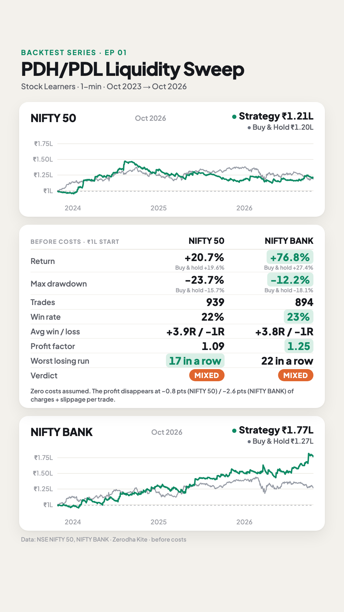
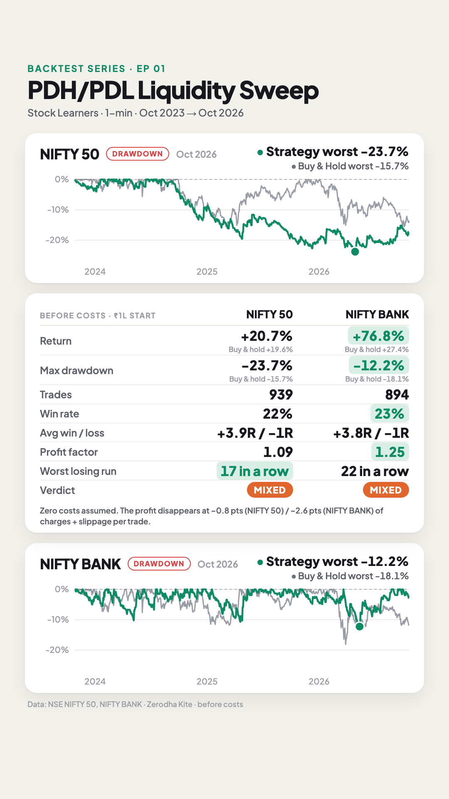

# E01 · PDH/PDL Liquidity Sweep (1-min scalping)

**Verdict: ⚠️ Mixed on both indices, and it loses money after realistic trading costs.**

- **Video tested:** "Best Trading Strategy For Beginners - Scalping Strategy" by Stock Learners / Gautam Jha (uploaded 2026-06-07) · https://www.youtube.com/watch?v=wI9b968AvW8
- **Creator's claim:** "around 50% accuracy at 1:10 risk-reward".
- **What we found:** about 22% wins at about 1:4. There's a small edge before costs, but it is smaller than the cost of trading.

| Equity + stats | Drawdown + stats |
|---|---|
|  |  |

## Results (Oct 2023 → Oct 2026, 1-minute, before costs, ₹1 lakh start)

| | NIFTY 50 | BANK NIFTY |
|---|---:|---:|
| Trades | 939 | 894 |
| Win rate | 22% | 23% |
| Avg win / avg loss | +3.9R / −1R | +3.8R / −1R |
| Profit factor | 1.09 | 1.25 |
| Return | +20.7% | +76.8% |
| Buy & hold return | +19.6% | +27.4% |
| Max drawdown (daily closes) | −23.7% | −12.2% |
| Buy & hold max drawdown | −15.7% | −18.1% |
| Worst losing streak | 17 | 22 |
| Last 12 months (out-of-sample) | +4.1%, PF 1.06 | +20.9%, PF 1.26 |
| **Cost per trade that wipes out the profit** | **~0.8 pts** | **~2.6 pts** |

R = the amount risked on a trade. +3.9R means the average winning trade made 3.9× what was risked.

Files:
- [`strategy.py`](strategy.py): the rules as code
- [`config.json`](config.json): instruments, period, sizing, sensitivity grid
- `results/NIFTY_50/` and `results/NIFTY_BANK/`, each with:
  - `summary.md`: full stats, in-sample vs out-of-sample, sensitivity table
  - `trades.csv`: every trade
  - `equity.csv`: daily equity vs buy & hold
  - `stats.json`: everything above, machine-readable

## Rules as stated in the video
1. **Levels:** on the daily chart, mark the previous day's high and low ("liquidity"); ignore the running candle.
2. **Timeframe:** drop to the 1-minute chart. If price stays between the lines, there's no trade.
3. **Short:** price goes above the previous-day high. Ignore the green and red candles up there until a *fresh* red candle forms, then enter short when the next candle breaks its low. SL goes above that candle.
4. **Long:** mirror image below the previous-day low (a fresh green candle, then the next candle breaks its high).
5. **Targets:** TG1 is the swing the market last reversed from; book most of the position there. Keep about 20% for a bigger target (the next swing). After the partial, the SL moves to cost. No trailing.
6. **Skip very wide SLs:** he skips "70–90 pips" and passes a 140-pip SL on gold. He takes 30–40-pip SLs.
7. **Per day:** at most 3 trades. Stop after 2 *full* stop-losses (a trade that booked a partial and then stopped at cost doesn't count as one).
8. **Instrument:** shown on Gold (XAUUSD). He says it can be used on BTC or Nifty/Sensex after your own backtest.

## Assumptions (where the video was vague)
| # | Video says | We assumed | Why |
|---|---|---|---|
| 1 | Gold (XAUUSD) | **NIFTY 50 and BANK NIFTY spot index, 1-min**, run separately | Kite has no multi-year 1-min gold history (continuous futures are daily-only); the creator says it works on Nifty/Sensex |
| 2 | "Fresh" red candle | Its high is a **new high of the day** and above the previous-day high | He rejects candles "in the middle" and says trades form at "fresh liquidity" only |
| 3 | Break "body low / candle low" | **Candle low** (wick) | Both phrasings are used; body close is tested in the sensitivity table |
| 4 | Break must happen "in the next candle" | Only the very next 1-min candle can trigger | Stated directly |
| 5 | SL "above it" | High of the setup candle | Stated directly |
| 6 | Skip big SLs (70–90+ pips on gold) | Skip if SL > **0.2% of price** | 80 pips ≈ $8 on ~$4,000 gold ≈ 0.2%. That is ~50 pts on NIFTY, ~110 on BANK NIFTY |
| 7 | TG1 = last swing | Most recent **confirmed** 1-min swing (5 bars each side) beyond the entry; TG2 = next swing beyond TG1 | A swing only counts once it is visible on the chart, so there's no lookahead |
| 8 | "Majority" at TG1, ~20% runner | 80% at TG1, then SL to cost; 20% to TG2, else squared off at 15:15 | 20% runner is stated |
| 9 | Previous-day high/low | From that day's 1-min candles | Within ~10 pts of Kite's daily candle |
| 10 | Entry window | Entries 09:16–15:00, forced exit 15:15 | Intraday index trading |
| 11 | Same candle touches SL and target / entry and SL | SL counted first | Conservative. 9–10% of trades are stopped on the entry candle; excluding them would lift avg R from 0.08 to ~0.19 (optimistic) |
| 12 | "Same position size" | Risk 1% of equity per trade, capped at 5× leverage (~index-futures margin) | The cap applies to ~90% of trades because 1-min SLs are tiny, so real risk per trade is ~0.2–0.3% |

## Data & limitations
- **Data:** NSE NIFTY 50 and NIFTY BANK spot index, 1-minute candles, 2023-10-26 → 2026-10-26 (756 days each), from Zerodha Kite.
- **Costs are zero** (series rule), so results are before brokerage, STT and slippage. **This matters a lot here:**
  - Median SL is **10.7 pts (NIFTY) / 34 pts (BANK NIFTY)**.
  - The edge disappears at **~0.8 pts (NIFTY) / ~2.6 pts (BANK NIFTY)** of cost per trade.
  - Real futures costs (STT ≈ 0.02% of value on the sell side ≈ 5 NIFTY pts, plus slippage on breakout entries) exceed both, so after costs both versions lose money.
- **The index itself isn't tradable.** Futures have a basis and options behave differently; entries and stops are filled at exact index levels.
- **Year by year (R):**
  - NIFTY: 2024 +119R, 2025 −49R, 2026 +24R, so the result is unstable.
  - BANK NIFTY: 2024 +55R, 2025 +8R, 2026 +19R.
- **Sensitivity:**
  - Using the candle body instead of the wick lifts BANK NIFTY to PF 1.41.
  - A tighter 0.1% SL limit makes it break even.
  - So the result depends heavily on rule choices (see `results/*/summary.md`).

## Reproduce
```bash
python run.py E01_2026-10-27_PDH-PDL-Liquidity-Sweep --no-video
```
