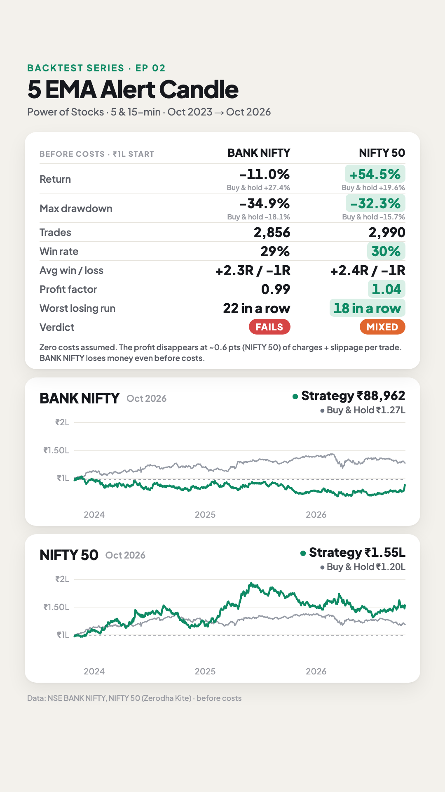
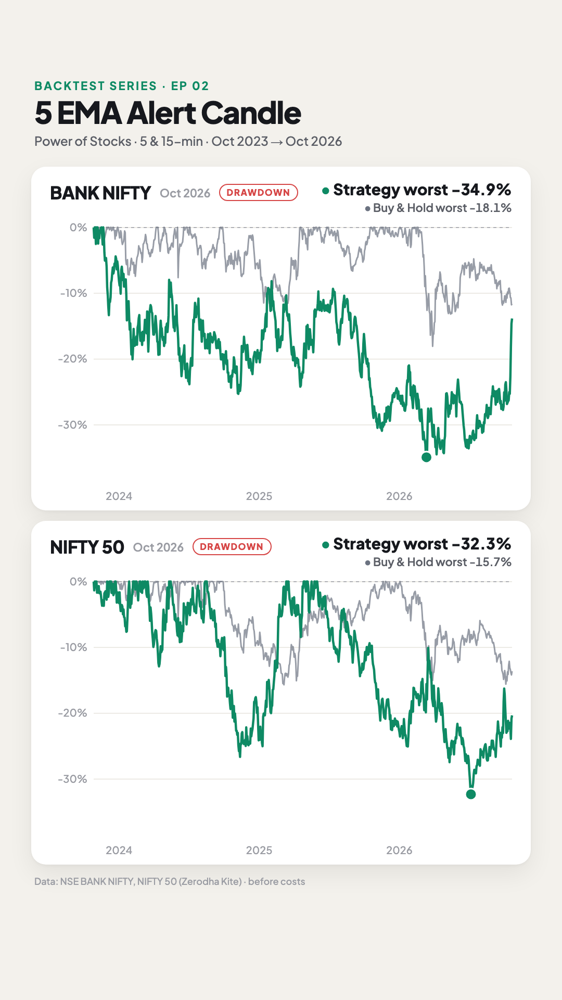

# E02 · 5 EMA Alert Candle (5-min sell, 15-min buy)

**Verdict: ❌ Fails on BANK NIFTY and ⚠️ Mixed on NIFTY 50. Win rates are about 29–30%, not 60–70%, and neither index makes money after realistic trading costs.** On BANK NIFTY, the market used in the video, it loses money even before costs.

- **Strategy by:** Subhasish Pani, of the **Power of Stocks** YouTube channel (his "5 EMA" setup).
- **Video tested:** "Scalping Strategy | 5 EMA Game Changer Setup | Trading in Share Market", published on Pushkar Raj Thakur's channel (uploaded 2022-09-23) · https://www.youtube.com/watch?v=uu3zGIXaG8g
  - The claims and timestamps below are from this video.
- **Creator's claims:**
  - "accuracy is 60–70%" (8:19)
  - "minimum 1:3" risk-reward (4:49)
  - "you can never miss a 90% or more trend reversal" (5:03)
- **What we found:**
  - Only 29–30% of trades win.
  - Only about 1 trade in 5 reaches the 1:3 target.
  - About 4 trades a day, with losing streaks of up to 22 in a row.
- **Markets:** BANK NIFTY (the index shown in the video) and NIFTY 50, each tested separately. Every test date is after the video was uploaded, so this is a true out-of-sample check.

| Equity + stats | Drawdown |
|---|---|
|  |  |

## Results (26 Oct 2023 → 26 Oct 2026, before costs, same starting capital)

| | BANK NIFTY | NIFTY 50 |
|---|---:|---:|
| Trades | 2,856 | 2,990 |
| Trades per day (avg) | 3.9 | 4.0 |
| Win rate | 29% | 30% |
| Trades that hit the 1:3 target | 19% | 21% |
| Avg win / avg loss | +2.3R / −1R | +2.4R / −1R |
| Profit factor | 0.99 | 1.04 |
| Return | −11.0% | +54.5% |
| Buy & hold return | +27.4% | +19.6% |
| Max drawdown (daily closes) | −34.9% | −32.3% |
| Buy & hold max drawdown | −18.1% | −15.7% |
| Worst losing streak | 22 | 18 |
| Last 12 months (out-of-sample) | +20.1%, PF 1.05 | −8.9%, PF 0.97 |
| Sell side (5-min) | PF 0.99 | PF 1.12 |
| Buy side (15-min) | PF 0.98 | PF 0.93 |
| Median stop-loss | 64.5 pts | 22.5 pts |
| **Cost per trade that wipes out the profit** | **none, it already loses** | **~0.6 pts** |

R = the amount risked on a trade. +2.4R means the average winning trade made 2.4× what was risked. The average win is below 3R because many trades never reach the target and are squared off at 15:15 instead.

Files:
- [`strategy.py`](strategy.py): the rules as code
- [`config.json`](config.json): instruments, period, sizing, sensitivity grid
- `results/NIFTY_BANK/` and `results/NIFTY_50/`, each with:
  - `summary.md`: full stats, in-sample vs out-of-sample, sensitivity table
  - `trades.csv`: every trade, including the alert candle's time and the chart it came from
  - `equity.csv`: daily equity vs buy & hold
  - `stats.json`: everything above, machine-readable

## Rules as stated in the video
1. **Indicator:** 5-period EMA on a normal candlestick chart.
2. **Sell setup (5-min chart):** a candle that **closes above** the 5 EMA and whose **low does not touch** the EMA is the *alert candle*. Its colour doesn't matter. If the next candle is also completely above the EMA, it becomes the new alert candle.
3. **Sell entry:** short as soon as price **breaks the alert candle's low**. The **SL is the alert candle's high**.
4. **Buy setup (15-min chart):** mirror image. A candle **closes below** the 5 EMA with its **high not touching** it. Go long when price breaks its high; the SL is its low.
5. **Target:** "minimum 1:3", never less.
6. **Re-entry:** after an SL, re-enter on the next setup, but **not more than 3 times a day**. Buy and sell sides are traded separately ("3 trades here, 3 trades here, total 6").
7. **Instrument:** shown on BANK NIFTY (via futures or options); he says it also works on liquid stocks.

## Assumptions (where the video was vague)
| # | Video says | We assumed | Why |
|---|---|---|---|
| 1 | Trade Bank Nifty through futures or options | **NIFTY BANK and NIFTY 50 spot index**, 1-min candles from Zerodha Kite, built into 5- and 15-min charts | Kite has no history for expired futures or options; the index is what the chart in the video shows |
| 2 | "Exponential moving average", period 5 | EMA(5) of the close, continuous across days (like a broker chart) | Stated directly |
| 3 | Alert stays valid "until the low is broken"; a new alert candle replaces it | Alert stays armed until it's **broken, replaced, or the day ends** | The video covers only those two cases; "next candle only" is tested in the sensitivity table (it's worse) |
| 4 | Entry when the low/high breaks | A stop order at the alert candle's low (sell) or high (buy), filled on the 1-min candle that breaks it; at the open if it gaps through | Stated directly; 1-min data shows which came first |
| 5 | SL = "same candle high", or the last swing | **Alert candle's high** (sell) / **low** (buy), no minimum or maximum | The "30–40 rupee" SL he mentions is an option-premium amount and doesn't translate to index points |
| 6 | Target "minimum 1:3"; trailing is "subjective" | **Full exit at 3R**; anything open is squared off at 15:15 | The only objective exit he gives. 2R, 4R and 5R are in the sensitivity table |
| 7 | "Not more than 3 times a day" | At most **3 trades per side per day** | He counts sell and buy trades separately |
| 8 | Entry window | Entries until 15:00; everything closed at 15:15 | Intraday scalping; never held overnight |
| 9 | Same candle touches SL and target / entry and SL | SL counted first | Conservative. Only ~2% of trades are stopped on their entry candle, so this barely changes the result |
| 10 | Position size | Risk 1% of equity per trade, capped at 5× leverage (~index-futures margin) | Same sizing as every episode in this series |

## Data & limitations
- **Data:** NSE NIFTY BANK and NIFTY 50 spot index, 1-minute candles from Zerodha Kite, 2023-10-26 → 2026-10-26 (741 trading days with trades). The 5- and 15-min charts are built from these and aligned to 09:15.
- **Costs are zero** (series rule), so results are before brokerage, STT, slippage and option decay. **This decides the verdict here:**
  - BANK NIFTY loses money even at zero cost.
  - On NIFTY 50 the edge disappears at **~0.6 pts** per trade, against a median SL of 22.5 pts. On futures, STT alone is ≈ 0.02% of value on the sell side ≈ 5 NIFTY pts, so after costs NIFTY 50 loses money too.
  - At ~4 trades a day, costs add up fast: about 2,900 round trips in 3 years on each index.
- **The index itself isn't tradable.** Futures have a basis and options behave differently; fills here are at exact index levels.
- **Year by year (R):**
  - BANK NIFTY: 2023 (Oct–Dec) −27R, 2024 −30R, 2025 −33R, 2026 +42R. It only turned positive in the last year.
  - NIFTY 50: 2023 (Oct–Dec) −6R, 2024 +3R, 2025 +69R, 2026 +30R.
- **Sensitivity** (one setting changed at a time; see `results/*/summary.md`):
  - **Sell side only** does better on NIFTY 50 (PF 1.12, +99.6%), which supports his point that selling moves faster. On BANK NIFTY it's still flat (PF 0.99).
  - **The 15-min buy side loses on both indices** (PF 0.98 and 0.93).
  - **A bigger target (1:5)** lifts both (PF 1.07 / 1.08). That's a choice made after seeing the data, and the edge is still thin.
  - **"Next candle only" alerts** are worse on both.
  - **1 trade per side per day** helps BANK NIFTY (PF 1.06) but hurts NIFTY 50. No single setting makes it robust on both.

## Reproduce
```bash
python run.py E02_2026-10-29_5-EMA-Alert-Candle --no-video
```
