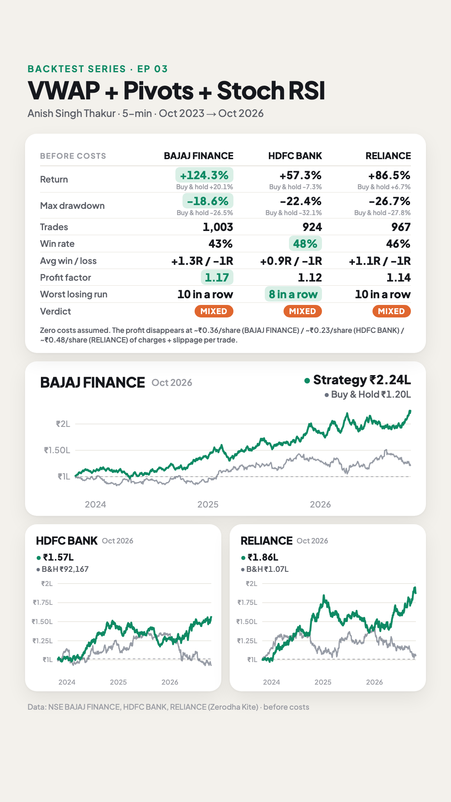
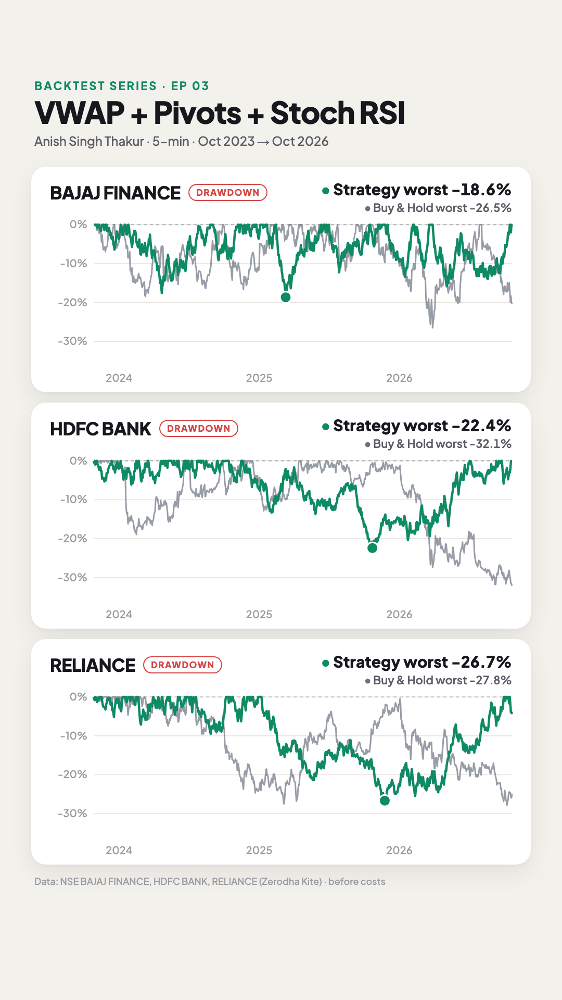

# E03 · VWAP + Fibonacci Pivots + Stochastic RSI (5-min intraday)

**Verdict: ⚠️ Mixed on all three stocks. It's profitable before costs on every stock and in every test period, but the edge per trade (0.03–0.04% of price) is smaller than intraday charges (~0.06%).** Before costs it beat buy & hold on all three, with smaller drawdowns.

- **Strategy by:** Anish Singh Thakur (Booming Bulls).
- **Video tested:** "Secrets of Intraday Strategy No One will tell you - VWAP PIVOTS STOCHASTIC RSI" by Booming Bulls (uploaded 2020-08-15) · https://www.youtube.com/watch?v=8OurAiVyhE4
- **What the video says:**
  - The rules, in his words (12:01): "10:45 is the first rule. Second is Pivot break, VWAP break, or the break of high or low of the day. And the third is Stochastic support."
  - He plays it forward on Bajaj Finance over about two weeks, "same rules", with "two stop-loss hits" (28:28).
  - "Strategy will definitely work for you" (31:53).
- **What we found:**
  - Over 3 years: 43–48% of trades win; only 11–21% reach the full 1% target. 35–56% are still open at 15:15 and get squared off.
  - About 27 trades a month per stock, with up to 10 losses in a row.
- **Markets:** Bajaj Finance (the stock in the video), plus HDFC Bank and Reliance, which he names at 27:56 ("Bajaj will pay you. Or HDFC or Reliance, that doesn't matter"). Each is tested separately.

| Equity + stats | Drawdown |
|---|---|
|  |  |

## Results (26 Oct 2023 → 26 Oct 2026, 5-min signals, 1-min fills, before costs, same starting capital)

| | Bajaj Finance | HDFC Bank | Reliance |
|---|---:|---:|---:|
| Trades | 1,003 | 924 | 967 |
| Trades per month (avg) | 27.9 | 25.7 | 26.9 |
| Win rate | 43% | 48% | 46% |
| Trades that hit the 1% target | 21% | 11% | 14% |
| Avg win / avg loss | +1.31R / −0.85R | +0.92R / −0.76R | +1.10R / −0.81R |
| Profit factor | 1.17 | 1.12 | 1.14 |
| Return | +124.3% | +57.3% | +86.5% |
| Buy & hold return | +20.1% | −7.3% | +6.7% |
| Max drawdown (daily closes) | −18.6% | −22.4% | −26.7% |
| Buy & hold max drawdown | −26.5% | −32.1% | −27.8% |
| Worst losing streak | 10 | 8 | 10 |
| Last 12 months (out-of-sample) | +32.9%, PF 1.16 | +31.3%, PF 1.22 | +23.6%, PF 1.15 |
| **Cost per trade that wipes out the profit** | **₹0.36/share (0.043%)** | **₹0.23/share (0.027%)** | **₹0.48/share (0.035%)** |
| Profit factor after ~0.06% charges per trade | 0.94 | 0.86 | 0.90 |

R = the amount risked on a trade (0.5% of price here). +1.31R means the average winning trade made 1.31× what was risked. The average loss is under 1R because trades squared off at 15:15 are often small losses rather than full stop-losses.

Files:
- [`strategy.py`](strategy.py): the rules as code
- [`config.json`](config.json): stocks, period, sizing, sensitivity grid
- `results/BAJFINANCE/`, `results/HDFCBANK/` and `results/RELIANCE/`, each with:
  - `summary.md`: full stats, in-sample vs out-of-sample, sensitivity table
  - `trades.csv`: every trade, including which level was broken (pivot, VWAP or day high/low)
  - `equity.csv`: daily equity vs buy & hold
  - `stats.json`: everything above, machine-readable

## Rules as stated in the video
1. **Chart:** 5-minute ("the best time frame for intraday").
2. **Indicators:**
   - Pivots: "Pivots Standard", type changed to **Fibonacci**, timeframe **Daily** (2:46). All levels (P, R1–R3, S1–S3) are treated the same.
   - **VWAP.**
   - **Stochastic RSI** on default settings: blue line crossing above red is a buy signal; crossing below is a sell signal.
3. **Time:** don't trade before **10:45** ("wake up late").
4. **Filter:** above VWAP, only buy; below VWAP, only sell.
5. **Entry:** when price **breaks a pivot level, VWAP, or the day's high/low**, in the VWAP direction, with Stochastic RSI supporting.
6. **Target:** about **1%** ("₹30 on a ₹3,000 stock"), or the next pivot. Take small profits, then stop trading for the day.
7. **Stop-loss:** "below VWAP, leaving ₹1–2 of space", "not too tight". Skip the trade if VWAP is too far away. Later: "a small stop-loss, say ₹15, and a target of ₹30. The ratio is 1:2" (30:00).
8. **Per day:** at most 2 trades. If the second trade also hits its stop-loss, stop for the day.

## Assumptions (where the video was vague)
| # | Video says | We assumed | Why |
|---|---|---|---|
| 1 | Bajaj Finance; "or HDFC or Reliance" | **BAJFINANCE, HDFCBANK, RELIANCE** cash market, 1-min candles from Zerodha Kite | His demo stock plus the two he names. Intraday cash equity can be traded exactly at these prices |
| 2 | Stop-loss "below VWAP" or "₹15 SL, ₹30 target, 1:2" | **0.5% stop-loss, 1% target** (his explicit 1:2) | The below-VWAP version is in the sensitivity table; it loses on all three stocks |
| 3 | Stochastic RSI "supports" (but at 19:23: "even if Stochastic doesn't indicate anything, that's not an issue") | Required: %K above %D for a buy, below for a sell, on the last closed 5-min candle | He lists it as rule 3. Leaving it out is in the sensitivity table |
| 4 | Enter on the break, or wait for the candle close | **On the break**: a stop order at the level, filled on the 1-min candle that crosses it | Most of his examples enter as price crosses ("put your limit order instantly"). Candle-close entry is in the sensitivity table |
| 5 | Which level to trade | The **nearest** pivot, VWAP or day high/low beyond the last 5-min close that leaves price on the right side of VWAP | E.g. a pivot below VWAP can't trigger a buy, because after the break price would still be below VWAP |
| 6 | Trendlines, horizontal lines, engulfing candles in some examples | **Not used** | These are extra confirmations in a few examples, not among his three stated rules ("you will acquire the skill with time", 27:20) |
| 7 | Trailing the stop for bigger profits (optional, "for experienced traders") | **No trailing**: fixed 1% target | He recommends beginners exit at ₹30 and stop |
| 8 | When to stop trading | Entries 10:45–14:30, everything closed at 15:15 | His examples run until about 14:00; intraday positions are squared off before the close |
| 9 | Same 1-min candle touches SL and target | SL counted first | Conservative |
| 10 | "Keep a risk of 2–3% … take only that much quantity" | Risk **1%** of equity per trade (≈ 2× leverage with a 0.5% SL) | Same sizing as every episode in this series |

## Data & limitations
- **Data:** NSE cash-market 1-minute candles from Zerodha Kite for BAJFINANCE, HDFCBANK and RELIANCE, 2023-10-26 → 2026-10-26. 5-min charts, VWAP (from 5-min typical price × volume), Stochastic RSI (14, 14, 3, 3) and Fibonacci pivots (previous day's high/low/close) are built from these.
  - Kite's prices are adjusted for the 2024–2025 bonuses and splits, so there are no artificial jumps.
  - From Aug 2026 the stocks' 1-min data ends at 15:14, so the 15:15 exit uses the 15:14 close on those days.
- **Costs are zero** (series rule), so results are before brokerage, STT, exchange charges and slippage. **This decides the verdict here:**
  - The profit per trade is **0.027–0.043% of price** (₹0.23–0.48 per share).
  - Zerodha's intraday equity charges on a ~₹2 lakh trade come to about **0.06% per round trip**: brokerage ₹40, STT 0.025% on the sell side, exchange charges, GST and stamp duty. That's before slippage.
  - After those charges all three lose money (PF 0.86–0.94).
- **Year by year (R):**
  - Bajaj Finance: 2023 (Oct–Dec) +11R, 2024 +22R, 2025 +33R, 2026 +23R.
  - HDFC Bank: +3R, +33R, −8R, +21R.
  - Reliance: +2R, +55R, −18R, +28R.
- **Which level was broken:** VWAP in about 40% of trades, the day's high/low in about 30%, pivot levels in the rest.
- **Sensitivity** (one setting changed at a time; see `results/*/summary.md`):
  - **The 10:45 rule matters.** Starting at 09:20 drops Bajaj Finance to PF 0.99 and Reliance to 1.06; HDFC Bank is about the same (1.10).
  - **Stochastic RSI helps** on Bajaj Finance (PF 1.17 vs 1.10 without it) and Reliance (1.14 vs 1.09); HDFC Bank is the same either way.
  - **Stop-loss just below VWAP loses on all three** (PF 0.84–0.94). It's often only a few rupees away, so it gets hit by noise.
  - **Entering on the 5-min candle close** instead of the break is slightly weaker (PF 1.09–1.17).
  - **Target:** 0.75% and 1.5% give similar results (PF 1.09–1.17).
- **Not tested:** trendlines, candle patterns and optional trailing (see assumptions 6–7). A rule-based test can only reproduce the three stated rules.

## Reproduce
```bash
python run.py E03_2026-10-30_VWAP-Pivot-StochRSI --no-video
```
