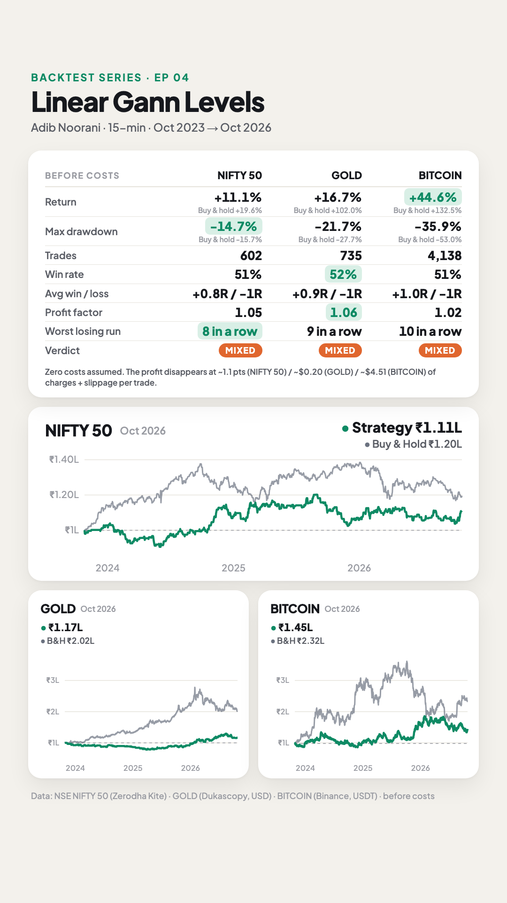
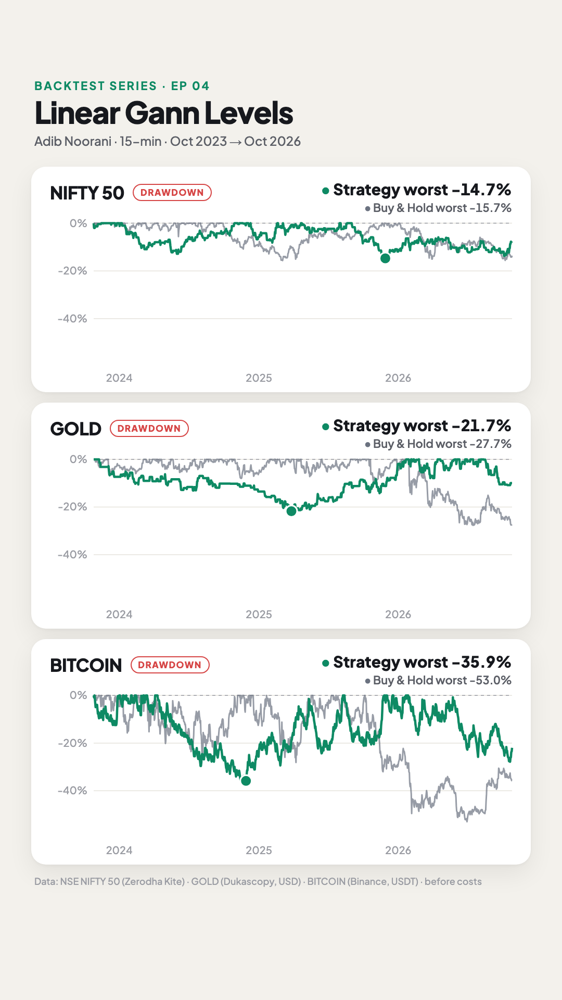

# E04 · Linear Gann Levels + candlestick patterns (15-min intraday)

**Verdict: ⚠️ Mixed on all three markets. It's slightly profitable before costs on NIFTY 50, gold and Bitcoin (profit factor 1.02–1.06, ~51% wins at 1:1), but the profit per trade (~0.005% of price) is smaller than trading costs on every market, and it trails buy & hold on all three.** Drawdowns are smaller than buy & hold on all three.

- **Strategy by:** Adib Noorani, explained as a guest on the *Trading Titans* podcast by InCred Money (host: Sahil Rohmehtra). The levels follow W. D. Gann's square-of-numbers idea; Adib's free TradingView indicator "Linear Gann 2.0" draws them.
- **Video tested:** "The Boring Trading Strategy that Actually Works (No one will tell you)" (uploaded 2026-09-23) · https://www.youtube.com/watch?v=ZaniJwJIwJg
  - The strategy is at 10:00–37:00.
- **What the video says:**
  - "Put it on any instrument in the world… commodities, gold, silver, crude, BTC, Ether, Nifty 500 stocks, any index in the world. It works unbelievably well everywhere" (11:00). Only small-cap, manipulated instruments are excluded.
  - Levels "never become weak; every time price comes, it reacts" (29:00–30:00).
  - Exit at 1:1 ("mera 1:1 hua na, main niklunga", 36:00).
- **What we found:**
  - About 51% of trades win at 1:1 on all three markets: a small edge before costs, but not enough to cover them.
  - His 2-stop-losses-a-day rule does help: without it, Bitcoin drops to PF 0.98.
- **Markets:** NIFTY 50 spot index (the chart in the video), spot gold (XAUUSD) and Bitcoin (BTC/USDT). He names all three. Each is tested separately on the same rules.

| Equity + stats | Drawdown |
|---|---|
|  |  |

## Results (26 Oct 2023 → 26 Oct 2026, 15-min signals, 1-min fills, before costs, same starting capital)

| | NIFTY 50 | Gold (XAUUSD) | Bitcoin (BTC/USDT) |
|---|---:|---:|---:|
| Trades | 602 | 735 | 4,138 |
| Trades per month (avg) | 16.7 | 20.4 | 114.9 |
| Win rate | 51% | 52% | 51% |
| Avg win / avg loss | +0.83R / −0.82R | +0.93R / −0.94R | +0.99R / −0.98R |
| Profit factor | 1.05 | 1.06 | 1.02 |
| Return | +11.1% | +16.7% | +44.6% |
| Buy & hold return | +19.6% | +102.0% | +132.5% |
| Max drawdown (daily closes) | −14.7% | −21.7% | −35.9% |
| Buy & hold max drawdown | −15.7% | −27.7% | −53.0% |
| Worst losing streak | 8 | 9 | 10 |
| Last 12 months (out-of-sample) | −1.8%, PF 0.98 | +30.5%, PF 1.18 | +29.1%, PF 1.03 |
| Median stop-loss | 61 pts (0.26%) | $10.1 (0.28%) | $320 (0.42%) |
| **Cost per trade that wipes out the profit** | **~1.1 pts (0.005%)** | **~$0.20 (0.005%)** | **~$4.5 (0.006%)** |

R = the amount risked on a trade. The average win and loss sit a little under 1R because some trades are still open at the end of the day and get squared off.

Files:
- [`strategy.py`](strategy.py): the rules as code
- [`config.json`](config.json): markets, period, sizing, sensitivity grid
- `results/NIFTY_50/`, `results/XAUUSD/` and `results/BTCUSDT/`, each with:
  - `summary.md`: full stats, in-sample vs out-of-sample, sensitivity table
  - `trades.csv`: every trade, including the pattern, the Gann level and the pattern's time
  - `equity.csv`: daily equity vs buy & hold
  - `stats.json`: everything above, machine-readable

## Rules as stated in the video
1. **Levels:** square every whole number; if the square is even, add 1. Near NIFTY 24,175: √ ≈ 155, so 155² = **24,025**, 156² + 1 = **24,337**, 157² = **24,649** (14:00–21:00). The levels are static and never change (38:00).
2. **Support or resistance:** a level above price is resistance; a level below price is support (23:00).
3. **Chart:** NIFTY spot, **15-minute** (22:00). He says 3- and 5-min also work, with more whipsaws (34:00).
4. **Setup:** one of six candlestick patterns at a level: **hammer, bullish engulfing, morning star** (buy) and **inverted hammer, bearish engulfing, evening star** (sell) (24:00–25:00). The pattern must **close** on the trade side of the level: "jis level ke neeche trade karna chah rahe ho, uske neeche close to chahiye" (32:00–33:00).
5. **Opening marubozu:** a 9:15 candle with open = high at a level → sell ("thoko", hit it) (26:00).
6. **Entry and stop:** "sell below the pattern with a 5–10 point buffer; stop-loss above it" (24:00, 28:00, 31:00).
7. **Target:** 1:1 (31:00, 36:00).
8. **Per day:** after 2 stop-losses in a day, stop ("market sideways hai", the market is sideways) (31:00). Intraday only; nothing carried forward (32:00).
9. **Every touch counts:** unlike supply/demand zones, Gann levels "never weaken"; trade every reaction (29:00–30:00).

## Replication check: does our code make his trades?
Before running 3 years, we checked the code against his own NIFTY 15-min examples (4–26 Aug 2026). We read the dates from his chart. Kite's candles match his to the paisa: identical highs, lows and closes. Only the 9:15 open differs slightly.

| His example (podcast time) | Our code |
|---|---|
| 4 Aug 9:45 inverted hammer at 24,649 → sell (23:00) | ✅ Same trade → target |
| 5 Aug 9:15 marubozu, open = high → sell (26:00) | ✅ Same trade → target |
| 5 Aug evening star, offered as an alternative entry (27:00) | ✅ Already in the same move via the marubozu |
| "4 successful trades at the top level" (31:00) | ✅ 4 targets at 24,649 on 4–7 Aug, plus a stop-loss he also mentions |
| 12 Aug bearish engulfing at 24,337 → loss (30:00) | ✅ Same bar → loss (squared off at −0.56R) |
| 14 Aug morning → stop-loss (31:00) | ✅ Stop-loss that morning (on the next pattern) |
| 14 Aug 13:30 bullish engulfing → "1:1 easily" (31:00) | 🟡 Same pattern, but price jumped 20 points within one minute through the entry, so our fill was worse and the 1:1 target wasn't reached |
| 17 Aug 15:15 engulfing → no trade (end of day) (31:00) | ✅ No trade |
| 19 Aug at 24,025 → "no proper trade here" (32:00) | ❌ We take 2 longs, both stopped out (the hammers came within 10–22 pts of the level but didn't touch it) |
| 26 Aug evening star skipped, then a proper bearish engulfing → sell (32:00–33:00) | ✅ Same, plus a 9:15 hammer long he doesn't mention (stopped out) |

About 8 of his 10 examples match on decision, direction and timing. The differences are at the margins: how close counts as "at the level", and execution in a fast candle. A stricter "must touch the level" rule removes the 19 Aug trades but also drops three of his trades. Both versions are in the sensitivity table, and they tell the same story.

## Assumptions (where the video was vague)
| # | Video says | We assumed | Why |
|---|---|---|---|
| 1 | NIFTY spot; "any instrument" | **NIFTY 50 spot** (Kite), **spot gold** (Dukascopy) and **BTC/USDT** (Binance), 1-min data built into 15-min candles | His demo market plus two he names. All three are liquid, which matches his "not small caps" condition |
| 2 | Pattern "at" a level; a near-miss is fine (17:00) | The pattern's range comes within **0.1% of price** of a level (~24 NIFTY pts) | This tolerance reproduced most of his examples; 0.02% ("must touch") and 0.2% are in the sensitivity table |
| 3 | Six textbook patterns, though "practice differs from the textbook" (17:00) | Standard definitions: hammer = lower wick ≥ 2× body and small upper wick; engulfing = body engulfs the previous body; star = small middle candle and third candle closes past the first one's midpoint | He also says each pattern merged into one candle is a hammer or inverted hammer (25:00), which these definitions follow |
| 4 | "5–10 point buffer" | **0.02% of price** (~5 NIFTY pts), for both entry and stop | Scales the same buffer to gold and Bitcoin |
| 5 | Sell "below the pattern" | A stop order that must trigger within **2 candles** (30 min) of the pattern, newest pattern first | Without an expiry, old setups fired hours later, which didn't match his examples; 1 and 4 candles are in the sensitivity table |
| 6 | 9:15 marubozu, open = high | First candle of the session with open within 15% of its range from the high and a body ≥ 60% of the range | Kite's 9:15 open differs slightly from the official open on his chart |
| 7 | Intraday | NIFTY: entries 09:30–15:00, exit 15:15. Gold: the broker day (17:00 New York close to close), exit 5 min before it. Bitcoin: the UTC day, exit at 23:55 | Gold and Bitcoin trade almost round the clock; the same "never overnight" rule |
| 8 | Max 2 stop-losses a day | Stop new entries for the day after the 2nd stop-loss | Stated directly |
| 9 | Same 1-min candle touches SL and target | SL counted first | Conservative |
| 10 | Position size | Risk 1% of equity per trade, capped at 5× leverage | Same sizing as every episode in this series |

## Data & limitations
- **Data:**
  - NIFTY 50: 1-minute spot index candles from Zerodha Kite.
  - Gold: XAUUSD bid prices, 1-minute, from Dukascopy (UTC).
  - Bitcoin: BTC/USDT 1-minute trades from Binance's public data archive (UTC).
  - All cover 2023-10-26 → 2026-10-26.
- **Costs are zero** (series rule), so results are before brokerage, taxes, spread and slippage. **This decides the verdict:**
  - The profit per trade is only ~0.005% of price on all three: ~1.1 NIFTY pts, ~$0.20 on gold, ~$4.5 on Bitcoin.
  - NIFTY futures: STT alone is ≈ 0.02% of value on the sell side (~5 pts). He also suggests in-the-money options; we didn't model option prices.
  - Gold: a typical spread of $0.20–0.30 already equals the whole edge.
  - Bitcoin: exchange fees of 0.02–0.1% per side are 7–35× the edge.
  - After costs, all three lose money.
- **The index itself isn't tradable.** NIFTY entries and stops are filled at exact index levels.
- **Year by year (R):**
  - NIFTY 50: 2023 (Oct–Dec) +3R, 2024 +6R, 2025 −4R, 2026 +7R.
  - Gold: −8R, −2R, +11R, +20R.
  - Bitcoin: −1R, +11R, +56R, +5R.
- **Which patterns worked (avg R per trade):**
  - NIFTY: evening star +0.12, inverted hammer +0.12, bearish engulfing +0.09; hammer −0.10, morning star −0.12.
  - Gold: evening star +0.10, bearish engulfing +0.08; morning star −0.16.
  - Bitcoin: close to zero for every pattern.
  - On NIFTY and gold, the sell patterns did better than the buy patterns.
- **Sensitivity** (one setting changed at a time; see `results/*/summary.md`):
  - **His 2-stop-losses-a-day rule matters.** Without it, NIFTY drops to PF 1.03, gold to 1.02, and Bitcoin to 0.98 (−48%).
  - **Tolerance:** "Must touch the level" (0.02%): PF 1.03 / 1.06 / 1.02. A looser 0.2%: 0.99 / 1.07 / 1.00. The result doesn't depend on this choice.
  - **Bigger targets:** 1:1.5 or 1:2 give PF 1.02–1.10; no clear improvement.
  - **Opening marubozu on or off:** almost no difference.
  - **Small buffer changes can flip single trades** (e.g. a 0.13-pt difference on 13 Aug 2026), but not the overall result.
- **Not tested:** the option trades he suggests (ITM puts, call selling), and the pattern-reading judgement he says comes with practice (17:00). The rules are tested as stated.

## Reproduce
```bash
python run.py E04_2026-10-31_Linear-Gann-Levels --no-video
```
