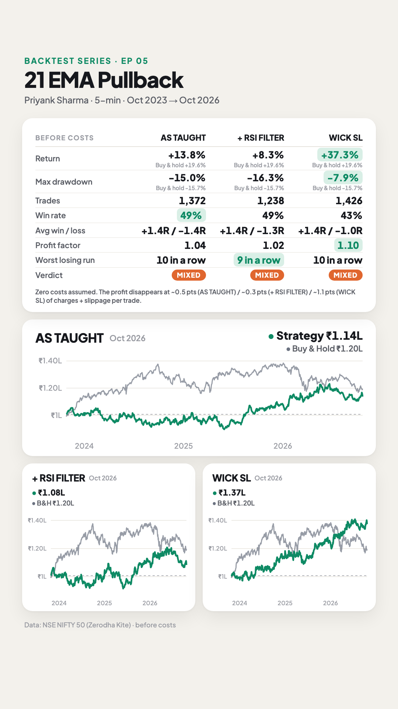
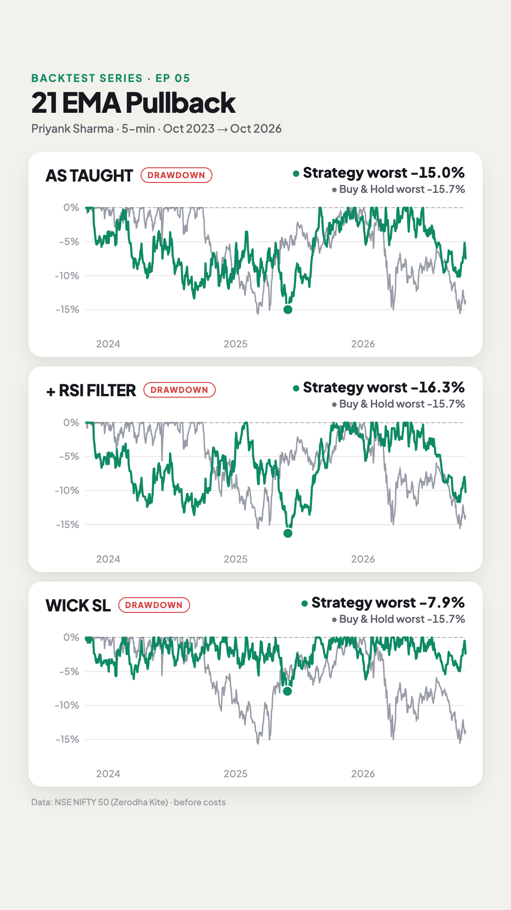

# E05 · 21 EMA breakout + pullback (NIFTY 50, 5-min intraday)

**Verdict: ⚠️ Mixed. Before costs, the rules as taught make +13.8% in 3 years (buy & hold +19.6%), with a 49% win rate at a 1.5R target. The average trade makes ~0.5 NIFTY points, less than trading costs. The wick-based stop he offers as an alternative did better (+37.3%, max drawdown −7.9%), but its edge (~1.1 pts a trade) is also below costs.**

- **Strategy by:** Priyank Sharma, *HOLD with Priyank* (SEBI-registered research analyst). He calls it the beginner strategy he used in his early days.
- **Video tested:** "FAST TRACK Your WEALTH with This INTRADAY Trading Strategy for Beginners!" (uploaded 2024-11-30) · https://www.youtube.com/watch?v=eKmr9Y8-bw0
  - The rules are at 10:00–27:00; a full week of live examples follows at 27:00–37:00.
- **What the video says:**
  - "Minimum risk-reward 1.5, but usually you'll get trades between 2R and 3R" (01:00).
  - "Even at 2R the target will go almost every time" (23:00).
  - He deliberately gives no win rate this time and asks viewers to test it (27:00).
  - In his example week: "about 8–9 trades, one stop-loss, the rest targets" (36:00).
- **What we found:**
  - 1,372 trades in 3 years (~38 a month, close to his 8–9 a week). 49% hit the 1.5R target first.
  - At a 2R target the win rate drops to 43% and the result turns negative (−19%).
  - His RSI 50 filter didn't help: +8.3% vs +13.8% without it.
- **Market:** NIFTY 50 spot index, the chart he uses throughout. Three versions run on the same data:
  - **As taught:** stop on a 5-min closing basis, his stated default.
  - **+ RSI filter:** as taught, plus his optional RSI 50 filter.
  - **Wick SL:** stop on touch, the alternative he mentions.

| Equity + stats | Drawdown |
|---|---|
|  |  |

## Results (26 Oct 2023 → 26 Oct 2026, 5-min signals, 1-min fills, before costs, same starting capital)

| | As taught | + RSI filter | Wick SL |
|---|---:|---:|---:|
| Trades | 1,372 | 1,238 | 1,426 |
| Trades per month (avg) | 38.1 | 34.4 | 39.6 |
| Win rate | 49% | 49% | 43% |
| Avg win / avg loss | +1.38R / −1.35R | +1.38R / −1.35R | +1.37R / −0.96R |
| Profit factor | 1.04 | 1.02 | 1.10 |
| Return | +13.8% | +8.3% | +37.3% |
| Buy & hold return | +19.6% | +19.6% | +19.6% |
| Max drawdown (daily closes) | −15.0% | −16.3% | −7.9% |
| Buy & hold max drawdown | −15.7% | −15.7% | −15.7% |
| Worst losing streak | 10 | 9 | 10 |
| Last 12 months (out-of-sample) | +9.6%, PF 1.08 | +0.6%, PF 1.01 | +12.6%, PF 1.12 |
| Median stop-loss | 17.8 pts (0.07%) | 17.7 pts | 17.6 pts |
| **Cost per trade that wipes out the profit** | **~0.5 pts** | **~0.3 pts** | **~1.1 pts** |

R = the amount risked on a trade.
- With a closing-basis stop, a loss is often bigger than 1R: the candle can close well past the stop. 54 trades lost more than 2R, and the worst lost 6.2R.
- Wins average a little under 1.5R because trades still open at 15:29 are squared off.

**How the sizing works here:** every episode risks 1% of equity per trade, capped at 5× leverage. His stops are so tight (median 18 points) that the 5× cap sets the position size on 97% of trades, so the typical trade risks ~0.37% of equity. In practice every trade is about the same size. That's why we give the cost that wipes out the profit at the sizes actually traded (total P&L ÷ total quantity) rather than from average R. In R terms the as-taught version is flat (total −1.7R over 1,372 trades).

Files:
- [`strategy.py`](strategy.py): the rules as code
- [`config.json`](config.json): market, period, sizing, the three versions, sensitivity grid
- `results/RULES/`, `results/RSI/` and `results/WICK/`, each with:
  - `summary.md`: full stats, in-sample vs out-of-sample, sensitivity table
  - `trades.csv`: every trade, with breakout time, pullback candle time and RSI
  - `equity.csv`: daily equity vs buy & hold
  - `stats.json`: everything above, machine-readable

## Rules as stated in the video
1. **Chart and indicator:** NIFTY 50, **5-minute** chart, **21 EMA** on the close. 20 or 22 "gives the same results" (03:00–12:00). He says 1-min and 15-min also work (01:00).
2. **Breakout:** a green candle **closes above** the EMA, coming from below (13:00–14:00).
3. **Pullback candle:** wait for the first **red** candle that **still closes above** the EMA. It can be 1, 2 or 3 candles later (14:00–15:00, 33:00).
4. **Entry:** a buy-stop at the pullback candle's **high**. It should trigger in the next candle, "max 2–3". He himself uses 2 (15:00–16:00, 28:00).
5. **Stop-loss:** the pullback candle's **low**, or a lower low if the next candle wicks below it first. Keep "a point or two" of gap (16:00, 23:00).
6. **Target:** **1.5R** first target; 2R if you prefer (16:00–17:00).
7. **Sell:** the mirror image. A red candle closes below the EMA, then a green candle still closes below it, and you sell below that candle's low (17:00–18:00).
8. **Don't trade when:**
   - many candles pass before the break (28:00),
   - price closes back across the EMA first (28:00–30:00),
   - the pullback candle forms "very far" from the EMA (33:00, 36:00).
9. **Stop on a closing basis:** exit only when a 5-min candle **closes** past the stop, not on a wick. He calls this the third key condition, and warns that a long 5-min candle can give a big loss (29:00–30:00, 35:00–36:00).
   - A wick stop is fine too: "your win rate drops about 10%, but targets come out much better" (36:00).
10. **Optional:** RSI above 50 for buys, below 50 for sells, "a high-probability setup" (25:00–27:00).

## Replication check: does our code make his trades?
Before running 3 years, we ran the code on the week he walks through: NIFTY 5-min, Mon 25 → Fri 29 Nov 2024 (19:00–37:00 in the video). We read his entries and stops off his chart.

| His call (video time) | Our code |
|---|---|
| 25 Nov, ~12:30 short (30:00–31:00) | ✅ Same trade: entry 24,277.20 (his 24,277.85) → target |
| 25 Nov, ~15:15 long, "first target same day" (31:00) | 🟡 Same entry and stop. His target (24,257.65) was reached by 0.4 pt at 15:25. With our 2-pt stop buffer the target sits 2 pts higher, so the trade is squared off at 15:29 at +1.05R |
| 26 Nov, ~09:55 short (worked example, 22:00–23:00) | ✅ Same trade → target |
| 26 Nov, ~11:40 long, "entry never triggered" (32:00) | ✅ No trade |
| 26 Nov, ~12:10 short, green candle "far below" the breakout, "avoid it" (32:00–33:00) | ✅ No trade: the green candle came 5 candles after the breakout |
| 27 Nov, ~11:00 long, "3-candle rule not followed, no trade" (34:00) | ✅ No trade |
| 27 Nov, ~12:15 long, running to "4R" (34:00–35:00) | ✅ Same trade → 1.5R target |
| 27 Nov, ~14:50 short (35:00) | ✅ Same trade → target |
| 28 Nov, ~14:05 long, his one stop-loss, about 94 pts on a closing basis (35:00–36:00) | ✅ Same trade → stop-loss, out at the 5-min close about 91 pts lower |
| 29 Nov, ~09:25 long (worked example, 19:00–22:00) | ✅ Same trade → target |
| 29 Nov, ~10:10 short, "never broke" (36:00) | ✅ No trade |
| 29 Nov, ~10:40 long, "the up-close candle formed very high, don't touch" (36:00) | ✅ No trade, **only with the near-EMA rule** (assumption 4 below). Without it, our code takes it and is stopped out |

11 of his 12 calls match, and the twelfth differs by 0.4 point.

Our code also takes 4 trades in that week that he doesn't comment on:
- **26 Nov 11:15 short:** its pullback candle is almost a doji, with a +0.5 pt body. Stop-loss.
- **26 Nov 13:55 long:** target.
- **27 Nov 09:40 short:** stop-loss.
- **29 Nov 15:22 short:** squared off at +0.25R.

So our week shows 11 trades with 3 stop-losses, against his "8–9 trades, 1 stop-loss".

## Assumptions (where the video was vague)
| # | Video says | We assumed | Why |
|---|---|---|---|
| 1 | NIFTY 5-min | **NIFTY 50 spot** (Kite), 1-min data built into 5-min candles | His chart. Kite's candles match his exactly on the bars we checked (e.g. 29 Nov 09:20: 23,969.55 / 23,992.75 / 23,958.70 / 23,964.60) |
| 2 | "Next candle, max 2–3" | The entry must trigger within **2 candles** of the pullback candle; 1 and 3 are in the sensitivity table | He says he uses 2 himself (16:00) |
| 3 | Pullback within "2–3 candles" of the breakout | Within **3 candles**; a newer qualifying candle replaces an untriggered one. 2 and 5 are in the sensitivity table | 33:00–34:00 |
| 4 | Pullback candle "very far" from the EMA: skip it | Its low (buy) or high (sell) must come within **0.1% of price** (~24 pts) of the EMA. Fixed after the replication check, before the 3-year run | The one skipped example (29 Nov) was 57 pts away; all his trades were within 4 pts. Without this rule the return is the same (+13.9%) but the drawdown is −26.8% |
| 5 | "A point or two" beyond the candle | **2 points** of stop buffer; 0 and 5 are in the sensitivity table | Stated |
| 6 | Stop on a closing basis | Exit at the close of the first 5-min candle that closes past the stop. "Wick SL" exits on touch | His default and his alternative |
| 7 | Intraday; he takes a 15:15 entry | Entries until **15:25**, square-off at **15:29** | His 25 Nov trade enters after 15:15 |
| 8 | Optional RSI | RSI(14) on the 5-min close at the pullback candle: above 50 to buy, below 50 to sell | Standard setting; he uses the 50 line |
| 9 | Same 1-min candle touches stop and target | Stop counted first | Conservative |
| 10 | Position size | Risk 1% of equity per trade, capped at 5× leverage (the cap sets the size on 97% of trades) | Same sizing as every episode in this series |

## Data & limitations
- **Data:** NIFTY 50 spot index, 1-minute candles from Zerodha Kite, 2023-10-26 → 2026-10-26.
- **Costs are zero** (series rule), so results are before brokerage, taxes, spread and slippage. **This decides the verdict:**
  - At the sizes traded, the profit per trade is ~0.5 pts (as taught), ~0.3 pts (+ RSI) and ~1.1 pts (wick SL).
  - NIFTY futures: STT alone is ≈ 0.02% of value on the sell side (~5 pts).
  - He trades options in the video; we didn't model option prices.
- **The index itself isn't tradable.** Entries and stops are filled at exact index levels.
- **Year by year (R), as taught:**
  - 2023 (Oct–Dec) +1.6R, 2024 −34.3R, 2025 +18.3R, 2026 +12.7R.
  - Wick SL: −5.0R, +8.9R, +18.2R, +26.8R.
- **Longs vs shorts (as taught):** shorts averaged +0.03R, longs −0.03R.
- **Sensitivity** (one setting changed at a time; see `results/*/summary.md`):
  - **Target:** 1.5R +13.8%, 2R −19.4% (win rate 43%), 3R −9.5%. His "2R almost every time" doesn't show up in 3 years of data.
  - **Stop type:** a closing basis wins more often (49% vs 43%) but loses more when it loses (−1.35R vs −0.96R). The wick stop ends higher: +37.3% vs +13.8%. This matches his own description of the trade-off.
  - **Stop buffer:** 0 pts +38.2%, 2 pts +13.8%, 5 pts +9.7%. The result is sensitive to this small detail.
  - **Entry window:** 1 candle −2.5%, 2 candles +13.8%, 3 candles +5.8%.
  - **RSI filter:** +8.3% vs +13.8% without it; last 12 months +0.6%.
- **Not tested:**
  - holding a runner to the next day (he mentions it as optional),
  - partial profit booking,
  - option trades,
  - the judgement he says comes with practice.
  
  The rules are tested as stated.

## Reproduce
```bash
python run.py E05_2026-11-01_21-EMA-Pullback --no-video
```
