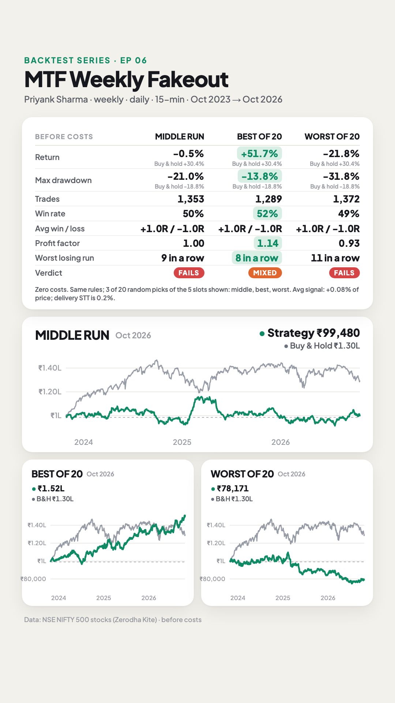
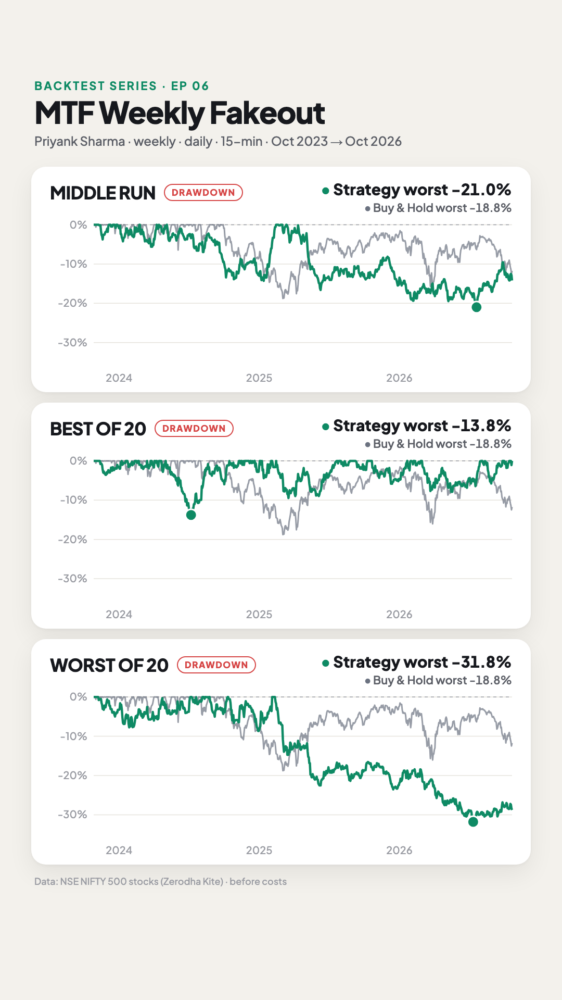
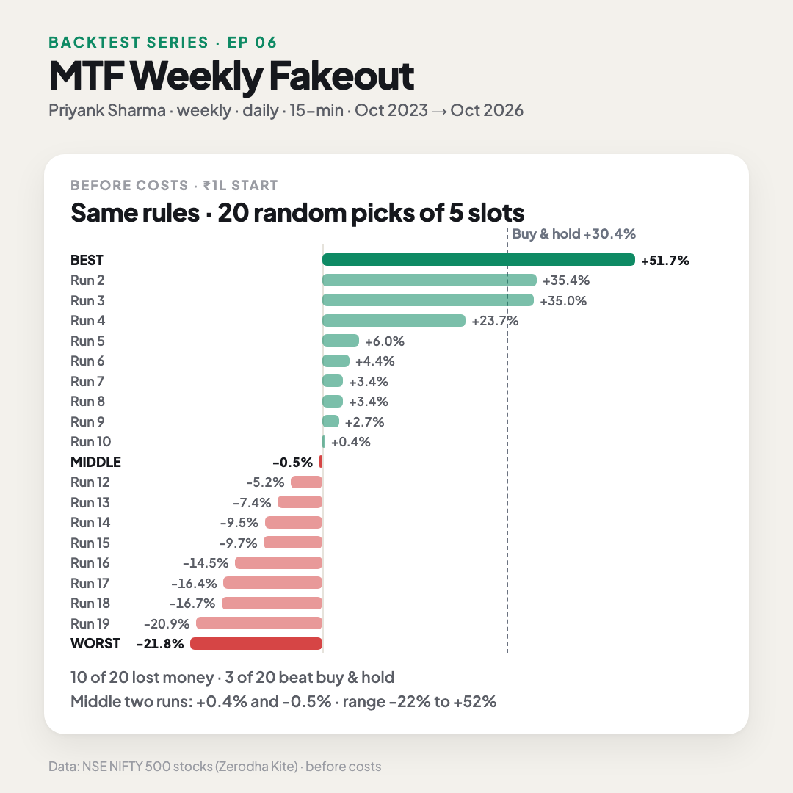

# E06 · MTF weekly fakeout (weekly → daily → 15-min swing) on Nifty 500 stocks

**Verdict: ❌ Fails as a ₹1 lakh account, with no clear edge across all signals. Across all 500 Nifty 500 stocks the rules fire about 636 times a month. Over 3 years, all 22,883 signals together average +0.08% of price per trade before costs, below delivery STT alone (0.2% round trip). A ₹1 lakh account can hold only 5 trades, and which 5 it takes is mostly chance: the same rules gave anything from −22% to +52% over 20 runs. The median run is shown: −0.5%, against +30.4% for buying and holding the NIFTY 500.** About half the trades reach the 1:1 target, against the 65–70% win rate he describes.

- **Strategy by:** Priyank Sharma, *HOLD with Priyank* (SEBI-registered research analyst).
- **Videos tested:**
  - **Main:** "MTF Trading Strategy - Secret Of Swing Trading", with Priyank as a guest on *Bazaar Ke Mahir* (uploaded 2025-02-28) · https://www.youtube.com/watch?v=XuW_VXHD7gc. The rules are at 04:00–22:00.
  - **His original:** "A Profitable Trading Strategy: SECRETS of Swing Trading REVEALED", on his own channel (uploaded 2024-10-18) · https://www.youtube.com/watch?v=45TB-joKhrQ. The BKM video calls this "the strategy I made public about 4 months ago". It has more worked examples and the exact trade management.
- **What the videos say:**
  - "Win rate 65–70% in an average market, 75–80% in a good one", and 80–85% with an extra support/resistance trick (original, 02:00).
  - Targets usually come in 2–3 days, "very rarely 10" (original, 01:00).
  - Use the top 100–200 stocks or F&O names; smaller stocks work too, in cash (original, 08:00).
- **What we found:**
  - Across all signals, 51% of trades end in profit and 48% reach the 1:1 target first.
  - Trades last 2 days at the median, as he says.
  - Short setups averaged +0.08R and long setups +0.02R.
- **Market:** all **500 stocks of today's Nifty 500**, traded from one ₹1 lakh account.

The video shows three of the 20 runs side by side: the middle run, the best and the worst.

| Equity + stats (middle, best, worst) | Drawdown | All 20 runs |
|---|---|---|
|  |  |  |

## Results (26 Oct 2023 → 26 Oct 2026, weekly/daily setups, 15-min entries and exits, before costs)

**1. The strategy itself: every signal on every stock, one trade per stock at a time, no account limit.**

| | All Nifty 500 signals |
|---|---:|
| Trades | 22,883 (~636 a month, from all 500 stocks) |
| Win rate (trade ends in profit) | 51.1% |
| Reached the 1:1 target | 48.3% |
| Average per trade | +0.05R · **+0.08% of price** |
| By year (avg R per trade) | 2023 (Oct–Dec) +0.03 · 2024 +0.07 · 2025 +0.06 · 2026 +0.01 |
| Shorts / longs (avg R) | +0.08 / +0.02 |
| Entries at the 9:15 open | 80% |

**2. A real ₹1 lakh account (shown in the video): the median of 20 runs.**

| | Median run (seed 15) |
|---|---:|
| Trades taken | 1,353 (37.6 a month; 458 different stocks) |
| Win rate | 50% |
| Reached the 1:1 target | 46% |
| Avg win / avg loss | +1.02R / −0.99R |
| Profit factor | 1.00 |
| Return | −0.5% (₹1,00,000 → ₹99,480) |
| NIFTY 500 buy & hold | +30.4% |
| Max drawdown (daily closes) | −21.0% |
| NIFTY 500 max drawdown | −18.8% |
| Worst losing streak | 9 |
| Last 12 months (out-of-sample) | −1.4%, PF 0.98 |
| Median stop-loss | 2.3% of price |
| Year by year (R) | 2023 +10 · 2024 +4 · 2025 −8 · 2026 +19 |

**How the account works:**
- **One ₹1 lakh account, at most 5 open trades.** Each trade risks 1% of equity, and each position is worth at most 20% of the account, so there's no leverage. The 20% cap binds on most trades, so a typical trade risks ~0.5% of equity.
- **Signals that arrive while all 5 slots are full are skipped.** About 37 of the ~636 monthly signals get taken.
- **80% of entries happen at the same moment** (the 9:15 open), so the account picks among them in a random order.

**3. Which signals the account picks changes everything.** The same rules and the same signals were replayed with 20 different random orders ([`robustness.py`](robustness.py), [`results/NIFTY500/seeds.csv`](results/NIFTY500/seeds.csv)):

| | Return | ₹1 lakh becomes | Max drawdown | Win rate | Profit factor |
|---|---:|---:|---:|---:|---:|
| Best of 20 (seed 0) | +51.7% | ₹1.52L | −13.8% | 52% | 1.14 |
| Middle run (seed 15) | −0.5% | ₹99,480 | −21.0% | 50% | 1.00 |
| Worst of 20 (seed 8) | −21.8% | ₹78,171 | −31.8% | 49% | 0.93 |
| NIFTY 500 buy & hold | +30.4% | ₹1.30L | −18.8% | | |

- **The two middle runs** (10th and 11th of 20) made +0.4% and −0.5%. The run shown is the second of these.
- **Skill wasn't tested.** Every run picks at random. A trader who chooses better among the day's signals (his "trick" of entering only near weekly/monthly support or resistance, for example) might land nearer the top of this range, and one who chooses worse nearer the bottom. That selection skill isn't part of the written rules.

- 10 of the 20 runs lost money.
- 3 of the 20 beat NIFTY 500 buy & hold (+30.4%).
- We show the median, not the best run.

R = the amount risked on a trade. A win averages about 1R: half the trade is booked at 1:1, and the other half either reaches the previous week's level (more than 1R) or comes back to breakeven.

Files:
- [`strategy.py`](strategy.py): the rules as code
- [`config.json`](config.json): universe, period, account settings, sensitivity grid
- [`robustness.py`](robustness.py): the 20-run check
- `results/NIFTY500/` (the middle run; `results/BEST/` and `results/WORST/` hold the best and worst runs shown in the video):
  - `summary.md`: full stats, in-sample vs out-of-sample, sensitivity table
  - `trades.csv`: every trade the account took, with setup day, swing level and fakeout extreme
  - `equity.csv`: daily equity vs NIFTY 500
  - `stats.json`: everything above, machine-readable
  - `seeds.csv`: the 20 runs

## Rules as stated in the videos
1. **Three timeframes, fixed:** weekly to read the crowd, daily to select stocks, 15-min to enter (BKM 04:00–05:00).
2. **Weekly:** mark the **previous week's high and low** (BKM 10:00; original 08:00–09:00).
3. **Daily: the fakeout.** Price trades above the previous week's high and a **daily candle then closes back below it**, on any of the first 4 days of the week; the same day counts. That's a sell setup. The mirror case (below the low, close back above) is a buy setup (BKM 07:00–12:00, 17:00–18:00; original 14:00–16:00).
4. **15-min: market-structure shift.** Take the **highest high** of the fakeout and the **last swing low before it** that sits below the weekly high. The setup triggers when a 15-min candle **closes below** that swing low (BKM 13:00–14:00; original 19:00–20:00). The mirror applies for buys.
5. **Entry timing:**
   - If the shift has already happened by the setup day's close, enter at the next morning's open (original 20:00–21:00; BKM 18:00).
   - Otherwise wait for it on the next day, and if it doesn't come that day, there's no trade (BKM 19:00).
6. **Stop-loss:** at the fakeout's highest high (original 22:00), "a little above it so a wick doesn't take you out" (BKM 21:00).
7. **Targets:**
   - At least 1:1. If the previous week's low is closer than 1R, skip the trade (original 21:00–22:00).
   - Book **50% at 1:1** and move the stop to entry. The rest runs to the **previous week's low** for sells, or high for buys (original 23:00; BKM 21:00).
8. **Universe:** liquid stocks such as F&O names or Nifty 50/100/200; "works in index too" (BKM 02:00, 12:00; original 08:00).
9. **Not part of the rules:**
   - His optional 80–85% "trick" (enter only near a weekly or monthly support/resistance, original 42:00) is a judgement call and isn't tested.
   - The same goes for his advice to skip an entry when the stock opens far away (original 35:00).

## Replication check: does our code make his trades?
Before running 3 years, we ran the code on every example he walks through with dates. Kite's candles match his charts (for example Cummins on 16 Oct 2024: high 3,846.10 on both). Only the daily close differs slightly: we use the last traded price, while TradingView shows the official close.

| His example (video time) | Our code |
|---|---|
| **CUMMINS INDIA**, short (BKM 16:00–22:00). Previous week high 3,825 / low 3,526. Wed 16 Oct 2024 trades above 3,825 and closes 3,798 below it. On Thu 17 Oct the 15-min close breaks the swing low at 3,776.05: short 3,746.90, stop 3,851.90. 1:1 is hit, then 3,526 on 23 Oct | ✅ Same setup day, the same swing low (3,776.05), stop 3,849.95, both targets by 23 Oct. Our entry is 3,758.20 at the open of the candle after the break; his is that candle's close. He says "anywhere in this candle is fine" |
| **ASIAN PAINTS**, week of 16 Sep 2024, short (his chart: previous week high 3,393 / low 3,258, swing line ≈ 3,353). Monday takes the high and closes below; Tuesday entry; target hit (original 31:00–32:00) | ✅ Same levels (swing 3,353.00) → 1:1 + weekly target |
| **ASIAN PAINTS**, buy on Fri 27 Sep 2024. Thursday's close back above the low; entry at Friday's open; "got very close to the target, you'd be at breakeven" (original 24:00–30:00) | ✅ Same entry. Closed at −0.08R when the next week's short setup reversed it |
| **ASIAN PAINTS**, short, setup Mon 30 Sep 2024. Entry Tuesday; 1:1 hit the next trading morning (original 10:00–23:00) | ✅ Same trade → 1:1 and the weekly target on 3 Oct (2 Oct was a holiday) |
| **ASIAN PAINTS**, week of 7 Oct 2024, buy (his chart: previous week low 3,054.55, swing-high line ≈ 3,077). Close above, entry next day, 1:1 next morning (original 33:00–34:00) | ✅ Same levels (swing 3,077.90) → 1:1, rest at breakeven |
| **ASIAN PAINTS**, live week of 14 Oct 2024. "It opened very high, don't enter there, wait" (original 35:00–36:00) | ❌ We enter at that gap open and get stopped out (−1R). His wait-for-a-pullback judgement isn't a written rule |
| **HDFC BANK**, buy. Previous week to 4 Oct 2024; close back above the low on Thu 10 Oct; 15-min shift by 3:15 pm; entry next morning; near the target by 16 Oct (original 37:00–40:00) | ✅ Same setup day, shift on the 10th, entry at the 11 Oct open → 1:1 + weekly target (prices are half his chart's because of HDFC Bank's 2025 bonus issue) |

6 of his 7 examples match on setup, direction, entry day and outcome. Two details were set from these examples before the 3-year run:
- **Swing point:** a swing low (or high) is a 15-min candle lower (or higher) than **1 candle on each side**. That's what gives his 3,776.05 on Cummins; 2 candles would pick 3,765.95.
- **Room check:** the 1:1 room to the weekly level is measured from entry to the fakeout extreme, as he does on the chart (Asian Paints, 30 Sep).

## Assumptions (where the videos were vague)
| # | Videos say | We assumed | Why |
|---|---|---|---|
| 1 | Top 100–200 or F&O stocks; smaller ones work too | **Today's Nifty 500** (NSE list, Nov 2026): 500 stocks, including 3 REITs and 2 in the BE series | Covers every universe he names. **Survivorship bias:** today's members, tested back to 2023. About 65 listed after Oct 2023 and are tested from their listing date |
| 2 | "Swing low" | A 15-min low below the candle on each side (1 candle); 2 is in the sensitivity table | Matches his Cummins level |
| 3 | Stop "a little above" the high | **0.1% of price** beyond the extreme; 0 and 0.3% are in the sensitivity table | BKM 21:00; his Cummins stop was 0.15% above |
| 4 | Book some at 1:1 | **50%** at 1:1, stop to entry, the rest to the previous week's level | Original 23:00: "50 kar lo, 50 chhod do" ("book 50, leave 50") |
| 5 | Usually 2–4 days, rarely 10 | Time exit at the close of the **10th trading day** after entry; 5 and 20 are in the sensitivity table | Not stated as a rule |
| 6 | One stock can give setups in both directions | One trade per stock at a time. An opposite-direction setup closes the open trade and reverses it; a same-direction setup is skipped | His back-to-back Asian Paints examples (27 Sep buy, 30 Sep short) |
| 7 | Daily close | The day's last 15-min close (last traded price) | TradingView's official close differs by a few rupees |
| 8 | Which stocks to take | One ₹1 lakh account, max 5 positions, 1% risk each, value ≤ 20% each; simultaneous signals taken in random order; the median of 20 orders is shown | He gives no ranking rule. A cash account can't take ~636 trades a month |
| 9 | Stop and target touched in the same 15-min candle | Stop counted first | Conservative |

## Data & limitations
- **Data:** Zerodha Kite 15-minute candles, 2023-10-26 → 2026-10-26. On a check stock (Adani Enterprises, 17,339 bars) they match 15-min candles built from 1-min data, to within 0.03%.
  - Stocks are split and bonus adjusted.
  - TMPV carries the pre-demerger Tata Motors history; TMCV is tested from its Nov 2025 listing.
- **Costs are zero** (series rule), so results are before brokerage, taxes, spread and slippage. **This decides the verdict:**
  - The average signal makes ~0.08% of price.
  - Delivery trades pay STT of 0.1% on both the buy and the sell, more than twice that.
  - Shorts held overnight can't be done in cash at all; they need stock futures or options, which we didn't model, and only about 200 Nifty 500 stocks have futures.
- **Survivorship bias:** today's members, especially the smaller ones, made it into the index because they did well, which can flatter long trades.
- **Sensitivity** (one setting changed at a time; see `results/NIFTY500/summary.md`):
  - On the median run, changing any one setting moved the return between −21% and +35%.
  - Each change also changes which signals fill the 5 slots, so these swings are mostly the same luck as the 20-run check, not a better or worse rule. Read them together with the all-signals table above.
- **Not tested:** his support/resistance "trick", options, and skipping gap-open entries. The rules are tested as stated.

## Reproduce
```bash
python run.py E06_2026-11-07_MTF-Weekly-Fakeout --no-video
python backtests/E06_2026-11-07_MTF-Weekly-Fakeout/robustness.py
```
Needs Kite 15-min data for the 500 stocks.
