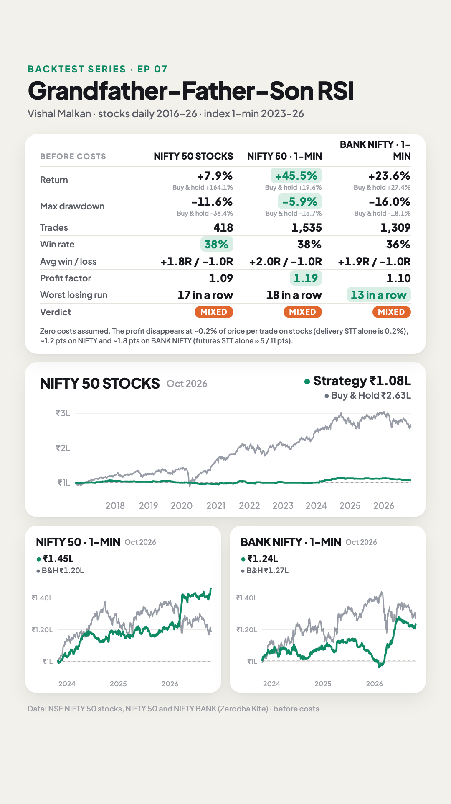
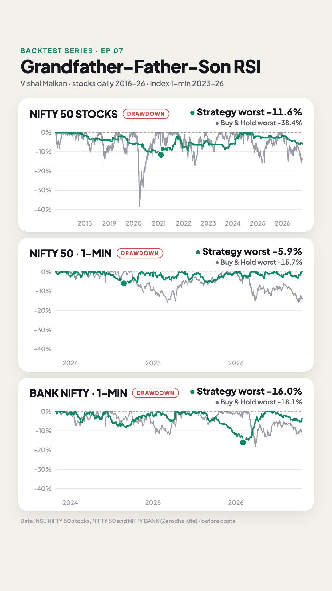

# E07 · Grandfather-Father-Son RSI (monthly → weekly → daily) on Nifty 50 stocks, plus the 15/5/1-min version on NIFTY and BANK NIFTY

**Verdict: ⚠️ Mixed on all three tests. On Nifty 50 stocks (10 years, daily) the rules took 418 trades with a 38% win rate and a profit factor of 1.09. The average trade made +0.20% of price before costs, which is about what delivery STT takes (0.2% round trip). The ₹1 lakh account made +7.9% while the NIFTY 50 rose +164%. The 1-minute version made +45.5% on NIFTY 50 (buy & hold +19.6%) and +23.6% on BANK NIFTY (buy & hold +27.4%) before costs. The profit disappears at ~1.2 (NIFTY) and ~1.8 (BANK NIFTY) index points per trade, well below what one futures trade costs.** About 4 in 10 trades reach the RSI-60 target; the other 6 hit the stop. That matches the "1 candle of risk for 4–5 candles of reward" shape he describes: average win +1.8R, average loss −1.0R.

- **Strategy by:** Vishal Malkan, as a guest on Pushkar Raj Thakur's channel.
- **Video tested:** "Learn Trading & Make Money in Stock Market / Forex / Crypto by Vishal Malkan" (*Pushkar Raj Thakur: Stock Market Educator*, uploaded 2022-01-15) · https://www.youtube.com/watch?v=s63l6K_ggCM. The rules are at 03:00–14:00.
- **What the video says:**
  - "High reward, low risk, high probability trade", "my bread and butter, this is my daily income" (14:00).
  - "It is not that it will work every time" (14:00).
  - About 1 candle of risk for 4–5 candles of profit (04:35); "1:3 risk reward" on one short example (11:44).
  - "This is a skeleton; the exact entry is in the Level 1 and Level 2 courses" (09:00). We test the rules as given in this free video.
- **What we found (Nifty 50 stocks, daily):**
  - Win rate 38%; average win +1.84R, average loss −1.00R; +0.07R per trade on average.
  - Median hold 6 days. Longs averaged +0.10R, shorts −0.15R.
  - Results swing by year: +20.5R in 2017, −10.7R in 2018, +36.5R in 2024, −13.2R in 2026.

| Equity + stats | Drawdown |
|---|---|
|  |  |

## Results (before costs)

| | Nifty 50 stocks · monthly/weekly/daily | NIFTY 50 · 15/5/1-min | BANK NIFTY · 15/5/1-min |
|---|---:|---:|---:|
| Period | 26 Oct 2016 → 26 Oct 2026 | 26 Oct 2023 → 26 Oct 2026 | 26 Oct 2023 → 26 Oct 2026 |
| Trades | 418 (~3.5 a month, 49 stocks) | 1,535 (~43 a month) | 1,309 (~36 a month) |
| Win rate | 37.8% | 37.8% | 35.6% |
| Avg win / avg loss | +1.84R / −1.00R | +1.97R / −0.98R | +1.94R / −0.99R |
| Profit factor | 1.09 | 1.19 | 1.10 |
| Average per trade | +0.07R · +0.20% of price | +0.13R · ~1.0 pt | +0.05R · ~1.3 pts |
| Return (₹1 lakh →) | +7.9% (₹1.08L) | +45.5% (₹1.45L) | +23.6% (₹1.24L) |
| Buy & hold | +164.1% (NIFTY 50) | +19.6% | +27.4% |
| Max drawdown | −11.6% | −5.9% | −16.0% |
| Buy & hold max drawdown | −38.4% | −15.7% | −18.1% |
| Worst losing streak | 17 | 18 | 13 |
| Last 12 months (out-of-sample) | −3.4%, PF 0.44 (28 trades) | +22.1%, PF 1.29 | +15.3%, PF 1.19 |
| Median stop distance | 2.9% of price | 0.04% (~9 pts) | 0.05% (~27 pts) |
| Year by year (R) | 2017 +20.5 · 2018 −10.7 · 2019 −4.8 · 2020 −4.0 · 2021 +7.0 · 2022 −0.9 · 2023 0.0 · 2024 +36.5 · 2025 +0.4 · 2026 −13.2 | 2023 +22.6 · 2024 +104.7 · 2025 +28.5 · 2026 +44.8 | 2023 +25.8 · 2024 +28.5 · 2025 −25.3 · 2026 +41.9 |

R = the amount risked on a trade (entry to the signal candle's stop).

**How the accounts work:**
- **Stocks:** one ₹1 lakh account, at most 10 open trades. Each trade risks 1% of equity and is worth at most 10% of the account (no leverage). Stops average ~3% of price, so the 10% cap sets the size on most trades and a typical trade risks ~0.3% of equity. That's why the return is small even though the R numbers are positive. The 10 slots were never all full, so no signal was skipped and the order in which signals were taken doesn't matter (checked over 20 random orders: all +7.9%).
- **Index, 1-min:** ₹1 lakh per index, 1% risk per trade, capped at 5× leverage (about index-futures margin). With ~9-point stops on NIFTY the cap sets the size on almost every trade. Trades are intraday: no new entries after 15:15, open trades close at 15:15.
- **Last 3 years on stocks** (the window the other episodes use): 139 trades, 44% win rate, +0.24R per trade.
- **Where NIFTY's 1-min gain came from:** Feb–Apr 2026 (NIFTY falling from ~25,600 to ~22,700, with big intraday swings) gave 96 trades and +40R, about a fifth of the 3-year total. The biggest single trade made ₹2,923.

Files:
- [`strategy.py`](strategy.py): the rules as code
- [`config.json`](config.json): universe, periods, account settings, sensitivity grid
- [`replication.py`](replication.py): the check against his 12 chart examples
- `results/NIFTY50_STOCKS/`, `results/NIFTY_1MIN/`, `results/BANKNIFTY_1MIN/`:
  - `summary.md`: full stats, in-sample vs out-of-sample, sensitivity table
  - `trades.csv`: every trade, with entry, stop, exit and R
  - `equity.csv`: daily equity vs buy & hold
  - `stats.json`: everything above, machine-readable

## Rules as stated in the video
1. **Three timeframes:** grandfather = monthly, father = weekly, son = daily. "The higher time frame rules" (03:34–04:04).
2. **Indicator:** RSI only, with lines at 40 and 60. His charts show **RSI 14** (06:14).
3. **Long setup:** monthly RSI above 60, weekly RSI above 60, and the daily RSI comes down to "40 or 41, sometimes 42 or 39" (05:11).
4. **Signal candle:** a bullish candle at that point (05:41).
5. **Entry:** buy above the signal candle's high (05:41).
6. **Stop-loss:** the signal candle's low (05:41).
7. **Target:** "As it takes a turn from 40 it will go till 60 minimum, that would be my target"; if it goes much further, trail the stop (05:41).
8. **Re-entry:** if the stop is hit but the daily RSI hasn't "put its foot below 40", take the same setup again (08:25).
9. **Short setup:** the mirror image. Monthly and weekly RSI below 40; daily RSI rises to "60, 61, 59, 58"; a red signal candle such as a shooting star or dark cloud cover; sell below its low, stop above its high. Shorts are for futures or options, not cash (10:41–11:13).
10. **Faster versions:** weekly/daily/hourly, daily/hourly/15-min, or 15-min/5-min/1-min for scalping. "Conditions are same" (12:55–13:26).

## Replication check: does our code find his signals?
We captured his charts from the video (frames kept privately; video times are given below so you can check them) and read the dates of the 12 signals he marks with arrows. A signal counts as found when the code has a signal candle within 3 trading days of his arrow ([`replication.py`](replication.py)).

| His example (video time) | Our code |
|---|---|
| **JSW STEEL**, long, end of Jan 2021 (07:05) | ✅ Signal 1 Feb 2021 → bought 2 Feb at 384.6, out at RSI 60 on 9 Feb, +1.5R |
| **JINDAL STEEL**, long, end of Jan 2021 (07:36) | ✅ Signals 28 Jan and 1 Feb → the first is stopped out the same day (−1R), the re-entry on 2 Feb makes +1.2R, as in his re-entry rule |
| **JINDAL STEEL**, long, early Jun 2021 (07:36) | ✅ Signals 31 May–7 Jun. We were already long from 28 May, which was stopped on 18 Jun (−1R) |
| **TATA STEEL**, long, end of Jan 2021 (08:08) | ✅ Signals 28 Jan and 1 Feb → stopped the same day (−1R), then re-entry on 2 Feb, +1.4R |
| **JUBILANT FOODWORKS**, long, late Oct 2020 (08:50) | ✅ Signals 23 and 28 Oct → entry 29 Oct, stopped the same day (−1R) |
| **JUBILANT FOODWORKS**, long, early Nov 2020: "the stop may have triggered… I enter again" (08:58) | ✅ Re-entry on 6 Nov, +1.1R |
| **JUBILANT FOODWORKS**, long, end of Jan 2021 (08:50) | ✅ Signals 28 Jan and 2 Feb → both stopped out (−1R each) |
| **JUBILANT FOODWORKS**, long, mid Mar 2021 (08:50) | ✅ Signal 19 Mar → entry 22 Mar, stopped 13 Apr (−1R) |
| **YES BANK**, short, end of Nov 2019 (12:04) | ✅ Signal 2 Dec. We were already short from 14 Nov; that trade ran through his arrow and exited at RSI 40 on 11 Dec, +2.4R |
| **TATA MOTORS**, short, early Apr 2018 (12:32) | ❌ Not found. That day the monthly RSI (unfinished April) was 43, not below 40 |
| **TATA MOTORS**, short, Aug 2018 (12:32) | ✅ Signal 21/23 Aug → short 23 Aug, stopped 7 Sep (−1R) |
| **TATA MOTORS**, short, Sep 2018 (12:32) | ✅ Signal 11 Sep → short 12 Sep, out at RSI 40 on 24 Sep, +1.2R |

**11 of his 12 marked signals are found.** Two readings were set from these examples before the 10-year run:
- **"Near 40" is a 35–45 band** (55–65 for shorts). With the literal "39 to 42" the code finds only 8 of 12, because his own arrows include dips to RSI 36.6 (Tata Steel) and 37.6 (Jubilant) and a bounce at 44–45 (Jindal Steel, June).
- **Monthly and weekly RSI are read as the chart shows them**, including the unfinished month or week. His JSW monthly chart (06:14) is dated 06/30/21 while the weekly ends 06/11/21, so the June candle was still forming. Reading the last completed month/week instead also finds 11 of 12; it is in the sensitivity table.

## Assumptions (where the video was vague)
| # | Video says | We assumed | Why |
|---|---|---|---|
| 1 | Stocks; examples are JSW Steel, Jindal Steel, Tata Steel, Jubilant, YES Bank, Tata Motors | **Today's Nifty 50** (NSE list, Nov 2026) | Liquid, well-known stocks. **Survivorship bias:** today's members, tested back to 2016. 7 listed after 2012 and trade once they have enough history |
| 2 | RSI near 40 ("39 to 42") | **35–45** on the signal candle or the candle before it | Matches 11 of his 12 arrows (see replication); 37 and 39 / 42 are in the sensitivity table |
| 3 | Monthly and weekly above 60 | The current month's and week's RSI as of that day's close | What his charts show; the completed reading is in the sensitivity table |
| 4 | "Bullish candle" (red for shorts) | Close above open (below for shorts) | Not defined further |
| 5 | Buy above the high | Stop order at the signal candle's high, valid for the next candle only. A gap above it fills at the open | Not stated how long the order stays |
| 6 | Target RSI 60, trail if it runs | Exit at the next open after the daily RSI closes at 60 or above (40 or below for shorts). No trailing | The trail method isn't given; RSI 55 and 65 are in the sensitivity table |
| 7 | Stop and entry in the same candle | Stop counted as hit | Conservative |
| 8 | Shorts in futures | Shorts on cash prices as a stand-in for stock futures | Kite has no expired stock-futures contracts; futures differ from cash only by the carry |
| 9 | One stock, one trade | One trade per stock at a time; a new signal while in a trade is ignored | Simplest reading |
| 10 | 15/5/1-min version | Same rules on 1-min candles of the NIFTY 50 and NIFTY BANK spot index; 15-min and 5-min RSI built from them, aligned to 09:15; flat by 15:15 | He says the same conditions apply; scalping is intraday |

## Data & limitations
- **Data:** Zerodha Kite daily candles (stocks, from 2010 for indicator warm-up) and 1-minute candles (indices, from Oct 2023). Stocks are split and bonus adjusted; TMPV carries the pre-demerger Tata Motors history.
- **Costs are zero** (series rule), so results are before brokerage, taxes, spread and slippage. **This decides the verdict:**
  - Stocks: the average trade makes ~0.20% of price. Delivery STT alone is 0.1% on the buy and 0.1% on the sell.
  - NIFTY 1-min: the profit disappears at **~1.2 points per trade** (at the sizes traded). On futures, STT alone is ≈ 0.02% of value on the sell side, about 5 NIFTY points.
  - BANK NIFTY 1-min: the profit disappears at **~1.8 points per trade**, against ~11 points of STT per futures trade.
  - Options (which he mentions) weren't modelled. Option premiums move less than the index, so the same index move earns fewer rupees per trade.
- **Survivorship bias:** today's Nifty 50 members did well enough to be in the index now, which can flatter long trades over 10 years.
- **Sensitivity** (one setting changed at a time; see each `results/*/summary.md`). On stocks:
  - His literal "39 to 42" band: 141 trades, PF 1.28, +8.2% (it finds 8 of his 12 examples). Band 35–42: 193 trades, PF 1.30, +12.1%. Band 39–45: PF 1.06.
  - Completed month/week instead of the unfinished one: 532 trades, PF 0.92, −8.5%.
  - Exit at RSI 65 instead of 60: PF 1.26, +26%. Exit at RSI 55: PF 1.02.
  - Longs only: PF 1.21, +15%.
  - Monthly/weekly above 55 instead of 60: 1,178 trades, PF 0.92, −15.9%.
- **Not tested:** the "exact entry" from his paid courses, trailing stops, options, and other timeframe pairs (weekly/daily/hourly, daily/hourly/15-min).
