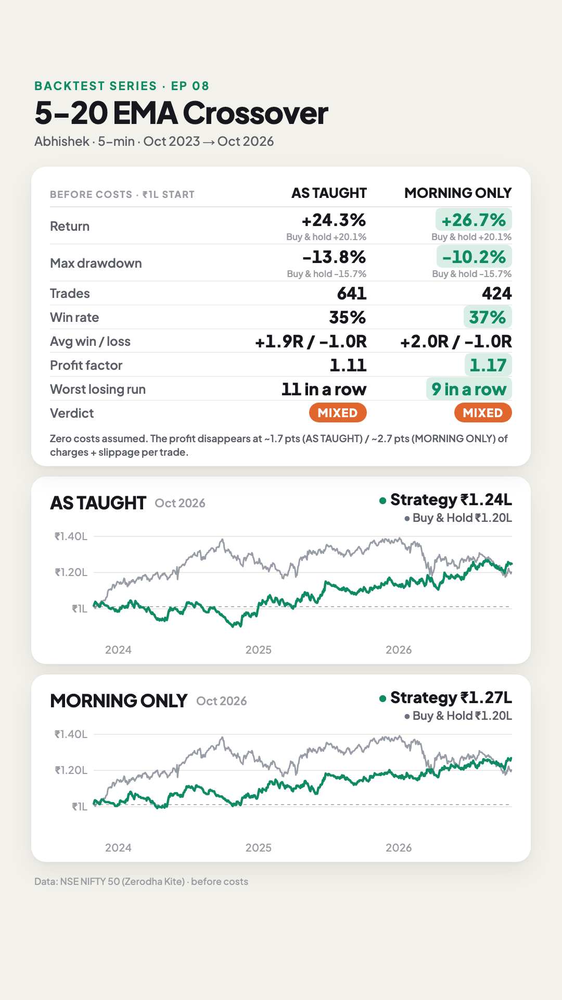
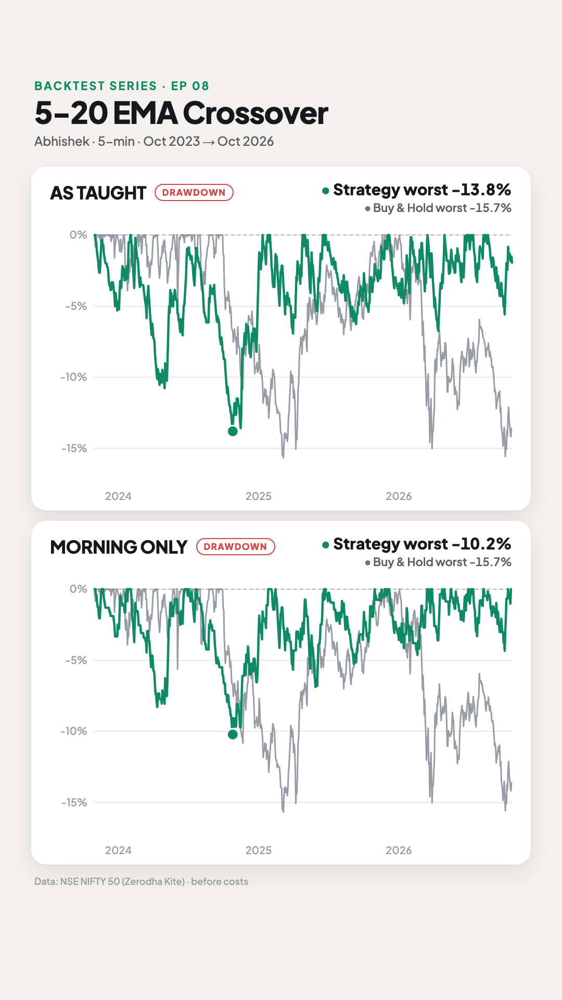

# E08 · 5-20 EMA crossover reversal (NIFTY 50, 5-min intraday)

**Verdict: ⚠️ Mixed. Before costs, the rules as taught make +24.3% in 3 years (buy & hold +20.1%), with a 35% win rate at his 1:2 risk-reward. The video says to expect 50–55%. The profit disappears at ~1.7 NIFTY points of cost per trade. Taking only morning trades (his "high-probability" window) gives +26.7%, a 37% win rate and a smaller drawdown.**

- **Strategy by:** Abhishek, *AbhishekXTrades*. He calls it the profitable EMA system he used himself a few years ago.
- **Video tested:** "Perfect Entry & Exit with 5-20 EMA Strategy (Intraday Reversal Mastery)" (uploaded 2025-06-15) · https://www.youtube.com/watch?v=AgDZVDuxrec
  - The rules are at 11:00–17:40. Seven worked examples on NIFTY, 5 → 13 June 2025, follow at 17:40–25:30.
- **What the video says:**
  - "Backtest it yourself on 1–2 years of data; I think you'll easily get 50–55% accuracy if you follow all the rules" (25:58).
  - "Even if you fail 5 times out of 10, with 1:2 it's a profitable system" (26:00).
  - His examples are "only 7–8 days of data" (25:58).
  - An FII/DII data filter (taught in another video) lifts accuracy to "70–75%". **Not tested here.**
- **What we found:**
  - 641 trades in 3 years (~18 a month). 35% reached the 2R target first.
  - Every rule variation we tried lands between 27% and 42% win rate (1.5R gives 42%).
  - Over his own example week, our code had 5 targets in 8 trades.
- **Market:** NIFTY 50 spot index, the chart he uses throughout. Two versions run on the same data:
  - **As taught:** every rule, entries all day until 15:00.
  - **Morning only:** entries until 11:30. He says morning setups are higher probability, and afternoon ones need a smaller size "or no trade at all".

| Equity + stats | Drawdown |
|---|---|
|  |  |

## Results (27 Oct 2023 → 27 Oct 2026, 5-min signals, 1-min fills, before costs, same starting capital)

| | As taught | Morning only |
|---|---:|---:|
| Trades | 641 | 424 |
| Trades per month (avg) | 17.8 | 11.8 |
| Win rate (video says 50–55%) | 35% | 37% |
| Avg win / avg loss | +1.95R / −1.00R | +1.96R / −1.00R |
| Profit factor | 1.11 | 1.17 |
| Return | +24.3% | +26.7% |
| Buy & hold return | +20.1% | +20.1% |
| Max drawdown (daily closes) | −13.8% | −10.2% |
| Buy & hold max drawdown | −15.7% | −15.7% |
| Worst losing streak | 11 | 9 |
| Last 12 months (out-of-sample) | +12.6%, PF 1.18 | +9.2%, PF 1.20 |
| Median stop-loss | 22.5 pts (0.09%) | – |
| **Cost per trade that wipes out the profit** | **~1.7 pts** | **~2.7 pts** |

R = the amount risked on a trade. At a 1:2 target a 35% win rate leaves a small profit: 0.35 × 2R − 0.65 × 1R ≈ +0.05R a trade before costs. The break-even win rate at 1:2 is 33%.

**How the sizing works here:** every episode risks 1% of equity per trade, capped at 5× leverage. With stops of ~22 points the cap sets the position size on 99% of trades (the typical trade risks ~0.45% of equity), so the cost line is given at the sizes actually traded (total P&L ÷ total quantity).

Files:
- [`strategy.py`](strategy.py): the rules as code
- [`config.json`](config.json): market, period, sizing, the two versions, sensitivity grid
- [`replication.py`](replication.py): lists the code's trades for any date range (used for the check below)
- `results/RULES/` and `results/MORNING/`, each with:
  - `summary.md`: full stats, in-sample vs out-of-sample, sensitivity table
  - `trades.csv`: every trade, with crossover time, crossover number, pullback candle and whether the stop was halved
  - `equity.csv`: daily equity vs buy & hold
  - `stats.json`: everything above, machine-readable

## Rules as stated in the video
1. **Chart and indicators:** **5-minute** chart, **5 EMA** and **20 EMA** on the close. Intraday (04:38–05:42).
2. **Crossover first:** no trade until the 5 EMA crosses the 20 EMA. Only the day's **first two** crossovers count. On the third, the market is "sideways" and you stop looking (11:25–12:27).
3. **Pullback candle:** after a bullish crossover, look for a **red** candle (after a bearish one, a **green** candle). The crossover candle itself can be it (12:59, 17:40).
4. **Two is a correction, three is a reversal:** up to 2 pullback candles in a row are fine. A 3rd in a row cancels the setup: "teen tigada, kaam bigada" (13:00–14:00, 21:16).
5. **Entry:** buy when price breaks the red candle's **high** (sell below the green candle's **low**), with a small buffer. It must break within the **next 3 candles**. If a newer pullback candle forms, the level moves to that candle. No break in 3 candles: wait for the next pullback candle (14:02–16:08, 19:43).
6. **Target:** **minimum 1:2** risk-reward; 1:3 or 1:4 if you like (16:08).
7. **Morning is better:** crossovers at 9:15–10:15 are higher probability. In the afternoon, trade smaller or skip (16:38).
8. **Stop-loss:** at the pullback candle's other end / nearest swing. **If the stop is big, halve it** (17:09, 23:56).
9. **No overtrading:** after a stop-loss, no more trades that day (25:28).

## Replication check: does our code make his trades?
Before running 3 years, we ran the code on his examples. Frames from the video show NIFTY 50 Index · 5 · NSE, Thu 5 Jun → Fri 13 Jun 2025. He walks backwards from 13 June. His position tool gives exact numbers for two of the trades.

| His example (video time) | Our code |
|---|---|
| Ex 2 · 12 Jun, short after a bearish crossover; two buyer candles, the level moves to the second (19:13) | ✅ Same trade: entry 09:55 → target |
| Ex 3 · 11 Jun, long; three sellers fail to break in 3 candles, the next one breaks (19:43–20:46) | ✅ Same trade: entry 10:32 → target |
| Ex 4 · 10 Jun, three buyers in a row, then a crossover with three sellers in a row: "no-trading day" (21:16) | ✅ No trade |
| Ex 5 · 9 Jun, short ~12:00, small stop, stop-loss (22:22; his tool: stop 11.3 pts) | ✅ Same trade: entry 12:02, stop 12.0 pts → stop-loss |
| Ex 6 · 6 Jun, no sell on the 1st crossover (3 greens), long on the 2nd; 3rd candle breaks; big stop halved (23:26) | ✅ Same trade: 2nd crossover, stop halved → target |
| Ex 1 · 13 Jun, long ~11:45, trigger on the crossover candle (17:40; his tool: stop 17.4 pts, target 34.9 → hit) | ❌ Different: on our data the EMAs are still 1.2 pts apart at 11:45 and cross one candle later. Our trade uses the 12:05 pullback candle → stop-loss |
| Ex 7 · 5 Jun, short ~13:15, trigger on the crossover candle (24:27) | ❌ Different: on our data the EMAs are 0.2 pts apart at 13:15 and cross at 13:20. Our trade enters at 13:58 → stop-loss |

5 of his 7 examples match exactly.

The other 2 differ for the same reason: on his chart the 5 and 20 EMA cross one candle earlier than on Kite's candles, where the lines are within 0.2–1.2 points of each other.
- We tried counting a "touch" (EMAs within 0.005% or 0.01% of price) as the crossover. That turned a matched example into a mismatch (it adds a 10 Jun trade on his "no-trading day"), so we kept the strict close-based crossover.
- The touch versions are in the sensitivity table: 36% win rate, the same picture.

## Assumptions (where the video was vague)
| # | Video says | We assumed | Why |
|---|---|---|---|
| 1 | 5-min chart (market not named aloud) | **NIFTY 50 spot** (Kite), 1-min data built into 5-min candles | His chart in every example |
| 2 | Crossover | The 5 EMA closes on the other side of the 20 EMA. EMAs run on across days, as on TradingView, so a cross on the day's first candle counts | His examples include morning crossovers |
| 3 | "A little buffer" on the level | **0.006% of price** (~1.5 pts) for entry and stop. 0 and 0.02% are in the sensitivity table | Fits his 13 Jun position: 17.4-pt stop on a 14.1-pt candle |
| 4 | Stop at the "swing" / candle | The pullback candle's low (buy) / high (sell) plus the buffer. "Swing" (extreme of the last 5 candles) is in the sensitivity table | His 9 Jun and 13 Jun stops match the candle, not a wider swing |
| 5 | "If the stop is big, halve it" | Halve it when it is wider than **0.2% of price** (~50 pts). 0.1% and never are in the sensitivity table | His halved example (6 Jun) had ~78 pts; his normal stops were 11–20 pts. Halved on 8.7% of trades |
| 6 | "Minimum 1:2" | Target **2R**. 1.5R and 3R are in the sensitivity table | The minimum he allows |
| 7 | Entry on break | A stop order: filled when the 1-min high/low touches the level (at the open if it gaps through) | He enters as the level breaks |
| 8 | Afternoon "lower probability" | As taught: entries until 15:00. Morning only: until 11:30 | He calls his 11:45 example "around afternoon" |
| 9 | One trade per crossover? | One trade per crossover, so at most 2 a day; none after a stop-loss | His examples |
| 10 | Intraday exit | Square-off at **15:20** (13 trades) | Not stated; standard intraday cut-off |
| 11 | Same 1-min candle touches stop and target | Stop counted first | Conservative |
| 12 | Position size | Risk 1% of equity per trade, capped at 5× leverage | Same sizing as every episode in this series |

## Data & limitations
- **Data:** NIFTY 50 spot index, 1-minute candles from Zerodha Kite, 2023-10-27 → 2026-10-27.
- **Costs are zero** (series rule), so results are before brokerage, taxes, spread and slippage.
  - At the sizes traded, the profit per trade is ~1.7 pts (as taught) and ~2.7 pts (morning only).
  - NIFTY futures: STT alone is ≈ 0.02% of value on the sell side (~5 pts).
  - He shows the index chart; we didn't model option prices.
- **The index itself isn't tradable.** Entries and stops are filled at exact index levels.
- **Year by year (R):**
  - As taught: 2023 (Oct–Dec) −6.0R, 2024 −2.1R, 2025 +20.4R, 2026 (to Oct) +14.8R.
  - Morning only: +0.1R, +4.6R, +15.2R, +14.2R.
- **Win rate by year (as taught):** 30%, 33%, 37%, 37%.
- **1st vs 2nd crossover of the day:** 34% vs 38% win rate.
- **Longs vs shorts:** 36% vs 34% win rate; +22.3R vs +4.8R.
- **Sensitivity** (one setting changed at a time; see `results/RULES/summary.md`):
  - **Target:** 1.5R +28.6% (42% win rate), 2R +24.3% (35%), 3R +13.9% (27%).
  - **Stop at the swing** instead of the candle: −1.0%.
  - **Halving big stops:** at 0.1% −14.2%, at 0.2% +24.3%, never +19.9%.
  - **Buffer:** 0 → +35.9%, 0.006% → +24.3%, 0.02% → +20.9%.
  - **Entry window:** 1 candle +19.5%, 2 +24.2%, 3 +24.3%.
  - **Pullback candles in a row allowed:** 1 → +27.6%, 2 → +24.3%, 3 → +27.6%.
  - **Last entry:** 11:30 +26.7%, 13:00 +28.8%, 15:00 +24.3%.
- **Not tested:**
  - the FII/DII data filter (another video),
  - smaller size on afternoon trades (morning-only is the nearest test),
  - 1:3 / 1:4 chosen trade by trade,
  - option trades.

  The rules are tested as stated.

## Reproduce
```bash
python run.py E08_2026-11-20_5-20-EMA-Crossover --no-video
python backtests/E08_2026-11-20_5-20-EMA-Crossover/replication.py "NSE:NIFTY 50" 2025-06-05 2025-06-13
```
